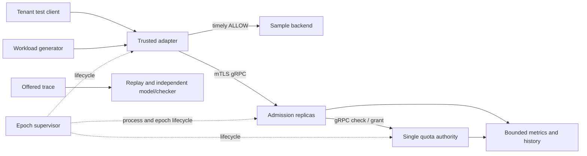
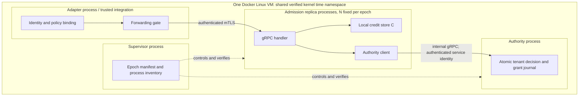
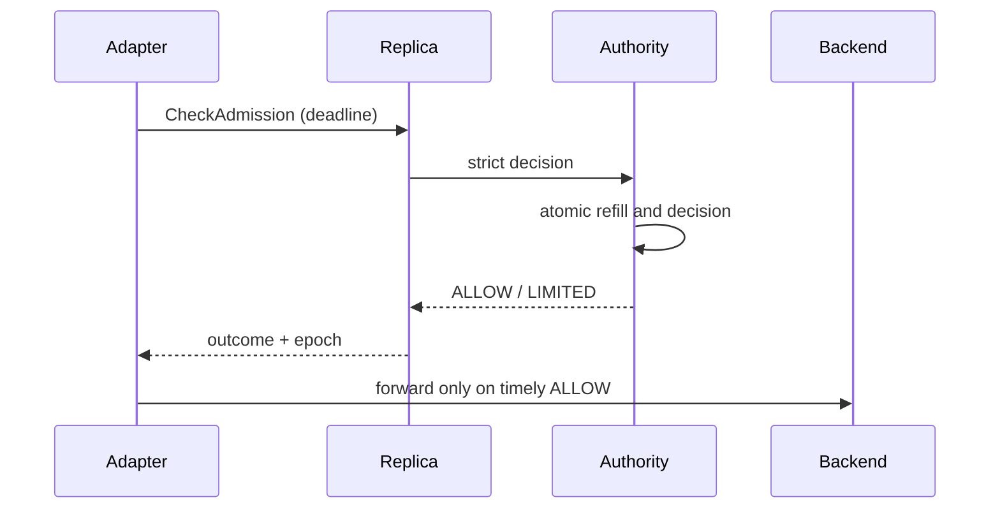

# DistributedRateGuard — High-Level Design

**Revision:** 1 · **Date:** 2026-11-04 · **Status:** Proposed; not implemented or verified  
**Sources:** [PRD revision 6](PRD.md) and [SRD revision 3](SRD.md), read from main.

## 1. Purpose, scope, and decision status

Backend and platform engineers need per-tenant admission decisions across replicas and reproducible evidence of the coordination/accuracy trade-off. Release A supplies strict atomic quota decisions; B supplies replay and evaluation; C supplies fixed-batch distributed credits and formal evidence. PRD-013 live policy changes and PRD-014 long-operation permits are deferred. Multi-host operation, automatic authority failover, production availability claims, and seamless cross-epoch quota continuity are excluded.

Accepted SRD D1–D9 and D11 are requirements. This HLD proposes a single C++ authority process with in-memory epoch state and a separately supervised durable epoch manifest. The prototype must establish whether this design can meet state-integrity, fencing and measurement obligations. No performance or safety result is claimed.

## 2. Drivers and quality attributes

| Driver | Contract | Architectural implication |
| --- | --- | --- |
| Per-tenant atomic budget, weighted costs | PRD-001–004; FR-002–004 | One logical authority serializes each tenant's updates; local credit spending has separate atomicity. |
| Deadline, unknown commit and failure | PRD-005/007/008/024; FR-006–008 | Timely ALLOW gates forwarding; uncertain spends are never refunded; all old spenders must be fenced before reset. |
| Latency and healthy responses | PRD-011/022; NFR-003/009 | Minimize check-path hops; measure p99 and all terminal/error denominators. Thresholds are targets. |
| Reproducibility and independent safety evidence | PRD-006/010–012/023; FR-011–013/021 | Freeze offered trace and configuration; independent model, checker, fault histories and seeded counterexamples. |
| Coordination savings with bounded burst | PRD-016–020; FR-014–019 | Fixed-Q grants reduce authority calls with an explicit B+rΔt+NQ envelope and stranded-credit cost. |

## 3. Context and components





The adapter is the trust boundary: untrusted client values never determine tenant, operation or cost. The adapter is separate to model a real integration. Replicas are separate processes to exercise concurrency and partition behavior. One authority owns all quota state and is deliberately a single point of failure. The supervisor controls lifecycle; generator, backend, offline replay and checker are independent processes, outside the quota path. No Redis, database, message queue or consensus service is selected.

## 4. Request and failure flows

### Strict admission (A)

1. A trusted adapter authenticates the upstream synthetic context, maps it to an allowed tenant/operation, and sends a deadline-bounded request over mTLS.
2. A ready replica checks epoch/digest, identity, policy, deadline and bounded resources; cost comes from the immutable policy.
3. The authority serializes the tenant transition, samples the common monotonic clock at its actual linearization point, refills with D3 arithmetic and atomically returns ALLOW with a debit or LIMITED without one.
4. The adapter forwards at most once only after receiving ALLOW within its deadline and active epoch. It returns distinct quota, validation and dependency outcomes.



Before observed deadline expiry at commit, no spend may occur. A timeout racing with commit can conceal a debit: the adapter does not forward, refund, or infer the result. A late ALLOW is ignored. An application retry is a new chargeable attempt; a correlation ID does not deduplicate it. Authority disconnect returns UNAVAILABLE rather than quota exhaustion.

### Credit admission (C)

1. A replica atomically spends from its confirmed local batch if enough remains. Otherwise it permanently retires the insufficient remainder.
2. The replica requests a grant for tenant, fixed slot/incarnation, epoch, digest, sequence and triggering cost; it has at most one grant in flight.
3. Authority atomically records a grant and sequence result with the debit: Q if available, otherwise floor(available) if it covers cost, else LIMITED with no debit.
4. Duplicate sequence calls replay the identical recorded result, including LIMITED after refill. A known result permits the next sequence; an unknown result permits only retry of the same sequence.
5. Only confirmed credits may be activated and spent. A partitioned replica can spend confirmed balance within its current epoch but cannot mint or obtain new credit. Crash or retired units are never refunded.

```mermaid
sequenceDiagram
 participant R as Replica
 participant Q as Authority
 R->>Q: AcquireCredit(sequence k)
 Q->>Q: atomic debit + persist result in epoch state
 Q--xR: response lost
 R->>Q: retry sequence k
 Q-->>R: identical recorded result
 R->>R: activate once; atomic local spend
```

## 5. State, consistency, and lifecycle

| State | Owner and consistency | Lifetime / failure |
| --- | --- | --- |
| Bucket balance, refill time | Authority; atomic serialized tenant transition, D3 fixed-point units and checked intermediates | Volatile for a single epoch; authority crash ends epoch. |
| Grant sequence and last result | Authority; debit and result written in one tenant/slot atomic transition | Volatile epoch state; duplicate replay only while epoch is active. Sequence never wraps. |
| Confirmed grant, local remaining, pending sequence | Replica; atomic per-tenant local spend | Bounded one batch/tenant/slot; crash strands balance. |
| Identity mapping, policy and digest | Immutable epoch configuration; adapter and authority validate digest | Fixed within epoch; unknown identities allocate no state. |
| Epoch/boot/clock identity and inventory | Supervisor; durable independently preserved manifest, atomic replacement and flush proposed | Missing, mismatched or rollback-suspect data stops activation; exact independent integrity mechanism is a blocker. |
| Offered trace, histories and reports | Evaluation tools, versioned schema, hashes and bounded output | Synthetic data; D7 retention and deletion; no unbounded identifier labels. |

In-memory authority state is a proposed simplification, not failover durability. Supervisor must detect authority process death and any missing or rolled-back tenant/sequence record before admission. **Open HLD-01:** a manifest alone cannot prove that a live process has not lost or rolled back an individual record. Choose and verify an independent integrity witness or fail-stop mechanism in LLD/prototype; until then FR-008 and AT-09 have no demonstrated mechanism.

The strict envelope is B+rΔt. Credit spends obey the conservative B+rΔt+NQ bound only within one epoch and on the validated shared clock. Unverified clock provenance makes the real-time result UNKNOWN, never PASS. New epoch initialization may restore B; no continuous cross-epoch envelope is promised.

## 6. Epoch creation, fencing, and recovery

The supervisor owns a fixed inventory of containers and slots, disables automatic restart, and records epoch ID, authority incarnation, boot ID, time namespace, clock ID and policy digest. Startup validates common clock provenance, config, mTLS identities, complete tenant state, slot registrations and authority identity before replicas or adapter become ready. An untrusted client cannot create tenant state.

On authority crash, state-integrity failure or identity change, the epoch becomes terminal. Stop ingress, stop every adapter and replica including isolated credit holders, and obtain positive exit/fencing evidence for every inventory entry. Close old channels, persist a fresh epoch identity and initialize fresh authority state, then start authority, replicas and adapter in order. If any participant cannot be proven stopped, new activation remains unavailable. Stopping only the adapter does not prevent an isolated replica from committing local spends.

A strict replica restart may rejoin only if SRD restart conditions and intact authority state are verified; a credit replica cannot reuse its old slot in the epoch. Adapter restart must not introduce a second forward for an attempt; exact idempotence evidence is an LLD decision. Clock mismatch blocks readiness. Transparent promotion or restoration of an old epoch is unsupported.

## 7. Security and trust

Registered adapters authenticate to admission replicas using gRPC mTLS with URI SAN principal identities. Immutable server-side epoch policy maps each principal to allowed synthetic tenant/operation pairs; the adapter derives upstream identity from trusted test configuration and ignores user override headers. Unknown operations, forged identities, unregistered or expired certificates and unauthorized pairs fail without quota mutation. Certificate rotation requires a stopped epoch and updated immutable configuration; live rotation is outside v1. Private keys, certificates, credentials and raw identity-bearing payloads are excluded from logs, metrics, traces and published examples. Internal replica-to-authority authentication and certificate provisioning are **HLD-02**, required before implementation.

## 8. Deployment and operations

Run all admission and authority processes in one Docker Linux VM, sharing and validating the same kernel time namespace; a macOS generator may run outside because server commit timestamps determine the bound. Health indicates process liveness; readiness additionally checks epoch, authority, policy, clock, principal and slot. The supervisor controls start/stop and refuses unsafe restart.

D6 caps: 10,000 configured tenants, eight replica slots, 1,024 pending checks/replica, 16 KiB request payload, 20 ms authority wait capped by caller deadline, and 1 GiB correctness history/run. Invalid or oversized inputs are rejected; queue saturation returns OVERLOADED; dependency wait expiry returns UNAVAILABLE/unknown as appropriate. A history cap invalidates the correctness run instead of silently dropping evidence. Unknown tenants cannot allocate state. D7 limits exported synthetic local histories to seven days and cleanup on next tool startup/run; published synthetic artifacts are versioned.

## 9. Capacity and evaluation

These are workload calculations, not benchmark results. At 5,000 offered checks/s, a 60 s run schedules 300,000 checks and 30 s warmup schedules 150,000. At 90% cost-1 and 10% cost-5, expected mean is 1.4 units/check, or 7,000 units/s; 1,000 evenly assigned tenants average 5 checks/s and 7 units/s each against r=100 units/s, B=100. This primarily measures service overhead, not sustained quota saturation.

Run open-loop with no retries: five 60 s measurements after 30 s warmup, three replicas, 1,000 tenants and 50 ms deadline. Each run requires p99 completed decision latency ≤5 ms, ≥99% delivered attempts timely ALLOW/LIMITED, and ≥99.5% scheduled arrivals delivered; errors/timeouts fail the terminal-response numerator. Publish scheduled/delivered/missed, per-outcome counts, p50/p95/p99, CPU/memory, raw data and manifest.

For tenant service, two tenants each offer 50 cost-1 attempts/s and a third offers 1,000/s, each r=B=100. Both conforming tenants require ≥99% timely ALLOW per run below the measured capacity knee. For credit efficiency compare identical offered traces, policy, routing, resources, deadlines and instrumentation; five-run median authority operations per 1,000 admitted cost units must fall ≥50%, preserve ≥95% of strict admitted cost and meet latency/service gates. Report bytes, unused/retired/stranded ranges, per-run results and burst deviation. N=1/3/8 and clamped Q sweep are sensitivity experiments; N=3 and Q=clamp(ceil(B/8),max_cost,B) is the fixed pass configuration. At least 1 million decision attempts per mode are required for correctness with seeded-defect detection, separate from performance runs. Two clean pinned reproductions must recalculate results.

**Conflict HLD-03:** SRD D8's deterministic replica routing assigns batches of 1,000 consecutive requests to one replica, while NFR-003 describes uniform routing. Aggregate equality does not ensure uniform short-window traffic. Freeze a corrected or explicitly interpreted trace only after PRD/SRD clarification; do not silently change the contract or certify the gate. Prototype clock-at-commit feasibility, throughput, p99, memory at caps, capacity knee, scheduler delivery and trace recording overhead before freezing the host manifest.

## 10. Alternatives and decision records

| Decision / driver | Proposed choice and benefit | Alternative, cost and revisit condition |
| --- | --- | --- |
| Authority storage, FR-002/008 | In-memory serialized authority, epoch-scoped, simple atomic state | Durable store adds I/O and recovery semantics; reconsider if integrity witness or measured performance requires it. HLD-01 remains open. |
| Replication, PRD-007 | One authority, explicit stop on failure | Consensus replication adds continuity but needs new failover product contract; reconsider for an availability goal. |
| Time, D4 | Shared Linux monotonic clock, provenance checked | Bounded cross-host uncertainty widens the envelope and needs new scope; reconsider for multi-host deployment. |
| Credits, PRD-016–020 | Fixed Q, one batch per slot, clear bound | Dynamic grants may reduce waste but require PRD change and fair baseline. |
| Fencing, D5 | Supervisor confirms every old process exit | Leases/consensus add timing assumptions; reconsider only with revised availability scope. |
| Replica state, FR-018 | Volatile credits; crashes strand capacity | Durable local journal may narrow stranded ranges but adds write-path cost; reconsider after measurements and contract review. |

## 11. Observability and diagnosis

Generator owns offered events; authority owns strict commits and grant charges; replica owns local spend and responses; adapter owns receipt and forwarding; backend owns completion. Bounded correctness histories carry immutable attempt and grant IDs, commit time, epoch and outcome. At quiescence reconcile completed ⊆ forwarded ⊆ timely received ALLOW ⊆ committed ALLOW; committed may exceed responded when responses are lost. LIMITED has no debit. Match grant charges to consumed, remaining, retired and stranded credit. After a crash with incomplete spend evidence report a conservative range, not an invented exact amount.

Publish aggregate outcome counts, pending/overload, latency, authority calls and bytes, credit accounting, trace/manifest hashes and run validity. Tenant, grant and correlation IDs are not metric labels. Offline replay uses complete offered attempts, immutable policies, initial state, explicit tie order and independent model; reject malformed or incomplete traces.

## 12. Requirement traceability

| PRD | SRD / owner | Mechanism and planned evidence |
| --- | --- | --- |
| 001–003 | FR-001–003, NFR-001 / authority | Atomic tenant state, D3, AT-01–04/21. |
| 004–005 | FR-004–006, NFR-002 / adapter, authority | Separate quotas, outcomes and deadlines; AT-05–07/22. |
| 006 | FR-011–012 / replay | Independent complete trace comparison; AT-12. |
| 007–008 | FR-001/003/007–008 / supervisor, authority | Epoch/identity checks and failures; AT-01/04/08–09; HLD-01/02 block completeness. |
| 009 | FR-009 / all event owners | Bounded stage events and reconciliation; AT-10. |
| 010–012 | FR-013, NFR-003/006/007 / evaluation | Frozen runs, p99 and clean reproductions; AT-13/23/25; HLD-03. |
| 013–014 | Deferred | Live policy changes and long-operation permits require new contracts. |
| 015 | FR-008/010, NFR-008 / supervisor, replica | Finite caps and fail-closed state; AT-09/11. |
| 016–019 | FR-014–018, NFR-001 / authority, replica, supervisor | Fixed slots, atomic grants/spends and fencing; AT-14–18/21; HLD-01. |
| 020 | FR-019, NFR-003–005 / evaluation | Paired efficiency and admitted-cost measurements; AT-19/23–24. |
| 021/023 | FR-020–021 / model and checker | Independent state machine and implementation-trace checking; AT-20/26. |
| 022 | NFR-009 / generator, adapter | ≥99% timely non-error outcomes; AT-27. |
| 024 | FR-001/003/008/017 / supervisor, adapter | Clock provenance, identity and positive fencing; AT-01/04/09/17/18; HLD-01/02. |

## 13. Review, risks, and work before LLD/code generation

- **HLD-01 — integrity witness:** specify how loss/rollback of an individual authority bucket or sequence record is detected independently before further admission; verify atomicity and crash fail-stop. A manifest alone is insufficient.
- **HLD-02 — internal authentication:** specify authority/replica service identity, credential provisioning, certificate validation and failure mapping.
- **HLD-03 — benchmark routing conflict:** resolve D8's time-batched routing versus NFR-003 uniform routing in source requirements before gate certification.
- **HLD-04 — atomic clock:** prototype how CLOCK_MONOTONIC is sampled at the true authority and local-spend linearization points and prove/check the time-bound mapping; timestamps sampled earlier over RPC cannot be assumed exact.
- **HLD-05 — supervisor fencing:** define durable inventory, positive process-exit evidence, handling of unreachable containers and epoch-manifest integrity under supervisor/host failure.
- **HLD-06 — concurrency and telemetry:** specify atomic state, journal retention, bounded history completeness, adapter at-most-once forwarding evidence, protobuf compatibility, and exact checker/trace schemas in LLD.
- **HLD-07 — experimentation:** measure host capacity, 5 ms p99 feasibility, 20 ms wait behavior, memory and generator accuracy; verify one million attempts/mode and injected faults. Model checking is bounded evidence, not a proof of every execution.

Review: strict mode consults the authority for every attempt; credit mode spends only confirmed batches and has a larger envelope. Neither refunds uncertain or lost work. Both guarantees end with the epoch. PRD-022 response and PRD-020 efficiency gates are independent of p99; all applicable gates must pass. None of the listed experiments has been run.

Before code generation: resolve HLD-01 through HLD-06 for affected modules, resolve HLD-03 in the source contract, pin an executable benchmark manifest, and write the LLD interfaces, invariants and independent acceptance methods. Record any remaining blocker against its requirement; do not infer a production-readiness claim.
