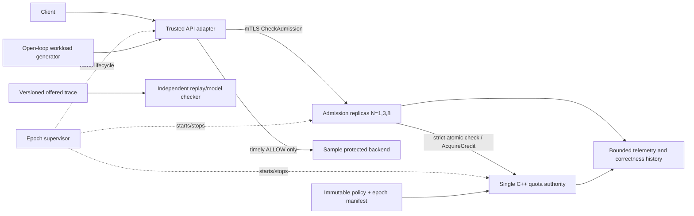

# RateGuard — High-Level Design

**Revision:** 1 · **Status:** Proposed architecture · **Date:** 2026-11-04  
**Inputs:** [PRD revision 6](PRD.md), [SRD revision 3](SRD.md)  
**Scope:** Releases A (strict core), B (evaluation), and C (distributed credits). This document specifies a design proposal; no implementation or measurements are claimed.

## 1. Architecture drivers

The design is driven by per-tenant isolation and atomic spending (PRD-001–004; FR-002/004), safe behavior on uncertain RPC outcomes and epoch changes (PRD-007/008/024; FR-006/008/015/018), reproducible policy evaluation (PRD-006/010–012), and measurable reduction in authority operations for credit mode (PRD-020/022). The service has one region and one Docker Linux VM. All authority and admission replicas share a verified Linux time namespace and CLOCK_MONOTONIC source (D4). Multi-host enforcement and transparent authority failover are out of scope.

## 2. System boundary and components

**Process boundaries:** one authority process, one to eight admission replica processes, a trusted adapter, a test backend, and workload/replay executables. Docker Compose on a single Linux kernel is the deployment boundary. Logical modules inside a process do not imply separate network services.

| Component | Responsibility and owned state |
| --- | --- |
| Adapter | Authenticates upstream test context, maps it to an authorized tenant/operation, calls admission, and forwards at most once on timely ALLOW. Does not own quota state. |
| Admission replica | Implements gRPC API, strict forwarding to authority, or credit-mode local spend. Owns only confirmed credit batches and local sequence state in credit mode. |
| Quota authority | Sole owner of tenant token buckets and grant sequence/result records for the active epoch. Serializes per-tenant state transitions. No peer authority or automatic promotion. |
| Epoch supervisor | Owns fixed process/container inventory, policy digest, epoch ID, clock provenance checks, startup order, and confirmed stop/restart procedure. |
| Replay and checker | Independently applies immutable policies to a complete offered trace and validates recorded concurrent histories; never calls production decision code as its oracle. |
| Generator/backend | Produces scheduled traffic and stage-owned events. Backend is a synthetic sink; no production service dependency. |

## 3. Request and failure flows

### Strict check (Release A)

1. The adapter validates its authenticated principal and resolves a trusted tenant and operation from immutable epoch configuration.
2. It sends CheckAdmission to any ready replica with correlation ID and caller deadline.
3. The replica validates epoch, digest, deadline, operation cost, and request bounds, then sends the check to the authority.
4. The authority samples CLOCK_MONOTONIC at the atomic tenant-state transition, refills, compares, and spends if eligible. Per-tenant locking or equivalent serialization defines the commit order.
5. The result identifies outcome, epoch, mode, policy digest, and correlation ID. Only timely ALLOW causes a single adapter forward. LIMITED never spends cost.

**Failure path:** If the caller deadline expires before authority commit, the request does not commit. If the response is lost after commit, the adapter treats the result as uncertain and does not forward or refund; an attempt ID and authority history expose committed-but-unforwarded cost. If the authority is unavailable or the epoch is invalid, the replica fails closed with UNAVAILABLE. A quota limit is not reported as a dependency failure.

### Credit check (Release C)

1. A replica first checks its local confirmed batch for the tenant and atomically subtracts the trusted operation cost when sufficient.
2. If insufficient, it retires any unusable remainder and requests a grant using the next sequence, slot, incarnation, epoch, policy digest, and triggering cost.
3. The authority atomically evaluates the same bucket and records the grant amount and sequence result. It grants Q when available; otherwise floor(available) if that covers the trigger; otherwise records LIMITED.
4. Duplicate sequence requests return the recorded result. Unknown outcome blocks sequence advancement. Only confirmed credit supports local ALLOW.
5. On authority partition, replicas may consume confirmed credits in the current epoch; they cannot get new grants. A replica restart or authority crash ends its epoch participation and can strand credits.

No timeout, process heartbeat, or elapsed delay returns credits. A fresh epoch cannot activate until the supervisor confirms exit of every old adapter and replica, including isolated credit spenders. An unknown process state blocks reset.

## 4. State, consistency, and persistence

Authority state is in-memory and epoch-scoped: tenant balance/refill timestamp, policy digest, per-slot grant sequence and last result, and bounded audit events. Per-tenant transitions are linearizable within the authority process. Credit replicas perform atomic local spends per tenant/slot. The system provides no authority failover or state migration.

The authority process is deliberately non-restarting within the same epoch. A crash, boot identity change, clock provenance mismatch, or state-integrity failure terminates the epoch. The supervisor stops all participants, writes a new monotonically increasing epoch identity and policy digest to a durable local manifest using atomic replace and fsync, then initializes fresh state. This avoids claiming that volatile bucket state can be recovered. Old epoch IDs are rejected by all newly started processes.

Tenant policy is immutable for an epoch and loaded from a versioned file whose canonical digest is included in every response and benchmark manifest. The supervisor’s manifest records epoch ID, authority incarnation, kernel boot identity, time-namespace identity, clock ID, fixed replica slots, configuration digest, and process/container inventory. Only synthetic identities are permitted. mTLS adapter certificates use registered URI SAN principals mapped to allowed tenant/operation sets.

No Redis, database, consensus group, or queue is introduced in v1. They add independent persistence/failover semantics that the product explicitly excludes. If a future requirement demands continuity across authority restart or multi-host high availability, this design must be replaced by a durable coordination design and a revised contract.

## 5. Deployment, limits, and capacity

Run all rate-enforcement processes inside one Docker Linux VM with one shared kernel and verified time namespace. The external load generator may run on macOS; only server-side monotonic commit times establish the quota history. Disable automatic container restart for authority and credit replicas; supervisor controls stop and epoch activation. Startup fails closed if clock namespace, boot identity, process inventory, certificate principal, policy digest, or epoch differs.

Apply SRD D6 limits: 10,000 configured tenants, 8 fixed replica slots, 1,024 pending checks per replica, 16 KiB request payload, and 20 ms authority wait capped by caller deadline. This bounds pending-check concurrency at 8,192 for N=8; memory usage must be measured and the limit reduced if the documented host cannot support it. Full correctness histories cap at 1 GiB/run; hitting the cap invalidates the run. Metrics use bounded labels and do not label by tenant, grant, or correlation ID.

Capacity arithmetic for the required performance workload: 5,000 offered checks/s × 60 s = 300,000 measured checks/run, plus 150,000 warmup checks. At the 90% cost-1 / 10% cost-5 mix, mean offered cost is 1.4 units/check, or 7,000 cost units/s total. With 1,000 uniform tenants, the mean is 5 checks/s and 7 cost units/s per tenant against r=100 units/s and B=100. This workload primarily tests service overhead and hot-path contention, not quota saturation. N=1/3/8 and Q sensitivity tests show scaling and stranded-credit behavior; these are workload calculations, not benchmark results.

## 6. Alternatives and decisions

| Decision | Selected approach and driver | Cost / alternative |
| --- | --- | --- |
| Authority ownership | Single in-process authority; simplest mechanism satisfying one logical atomic owner and explicit no-failover scope. | Authority is a single failure point and needs supervised epoch reset. Redis/etcd or replicated authority would add durability and failover contracts outside v1. |
| Strict state | In-memory per-tenant bucket with atomic serialized transition; FR-002 and strict baseline. | Hot tenants serialize. A Redis Lua authority is credible but adds an external datastore and timing/persistence semantics; revisit only if prototypes miss targets. |
| Credit batches | Fixed-Q baseline, one batch per tenant/slot; maps directly to B+rΔt+NQ bound and PRD comparison. | Stranded credits and larger burst envelope. Adaptive allocation requires a later PRD amendment. |
| Time | Shared kernel CLOCK_MONOTONIC with verified time namespace; supports an auditable common timeline for this local deployment. | Cannot support a tight cross-host real-time claim. Multi-host clocks require a bounded uncertainty model or a weaker bound. |
| Epoch reset | Stop and positively confirm every old process before new epoch. | Reset may be blocked by an unreachable process; intentional fail-closed behavior. Lease or consensus fencing would expand scope. |

## 7. Observability and recovery

Emit bounded aggregate metrics for offered, committed, responded, forwarded, completed, LIMITED, unavailable, overloaded, invalid, and unresolved events, plus latency, authority calls/bytes, grant/consume/retire cost, and run manifest. Correctness histories carry immutable attempt/grant IDs and the source component. Reconcile at quiescence: completed ⊆ forwarded ⊆ timely received ALLOW ⊆ committed ALLOW; committed may exceed responses after a lost reply. Grant charges reconcile against consumed, remaining, retired, and stranded units; after replica crash, report a conservative stranded range unless durable local spend evidence exists.

Recovery is a supervisor operation: stop ingress; stop and confirm all old processes; mark the old epoch terminal; validate policy and host clock context; allocate a fresh epoch ID; initialize a fresh bucket state; then start authority, replicas, and adapter in that order. No component silently rejoins an old epoch after restart.

## 8. Requirement trace and risks

| Requirement | Architectural mechanism |
| --- | --- |
| PRD-001–005 / FR-001–006 | Trusted adapter boundary, authority-owned atomic buckets, explicit result contract and deadline-aware forwarding. |
| PRD-007/008/024 / FR-007/008/014/018 | Supervisor-owned epoch lifecycle, verified manifest and clock identity, fail-closed recovery. |
| PRD-015 / NFR-008 | Per-process request caps, finite tenant configuration, bounded histories and overload responses. |
| PRD-016–019 / FR-014–018 | Fixed slots, unique grant sequence journal, atomic local spend, no refunds/reclamation, conservative failure accounting. |
| PRD-006/010–012 / FR-011–013 | Versioned deterministic traces, independent replay model, frozen manifests and clean reproductions. |
| PRD-020/022 / NFR-002–005/009 | Paired strict/credit runs, fixed metric denominators, timely terminal outcome gate and publication of raw results. |
| PRD-023 / FR-021 | Bounded state exploration and trace-to-model validation with seeded counterexamples. |

**Risks and required experiments:** Prototype authority throughput and p99 under 5,000 open-loop checks/s before freezing the host manifest. Verify the selected storage/locking implementation uses the same CLOCK_MONOTONIC source at its true atomic commit point. If an embedded authority cannot do this or cannot provide the required atomicity, implement the authority as a single C++ service process rather than relying on database-generated wall-clock timestamps. Measure memory at the 10,000-tenant and 1,024-in-flight bounds. Exercise process kill, partition, stale epoch, certificate expiry, and correctness-history overflow. None of these experiments has yet been run.

## 9. Status

This HLD is a proposed architecture aligned to PRD 6 and SRD 3. It does not claim implementation, benchmark success, formal proof, or production readiness. Detailed protobuf schemas, lock/state transitions, journal record encoding, supervisor command protocol, and exact process APIs belong in the LLD after these architectural choices are reviewed.
