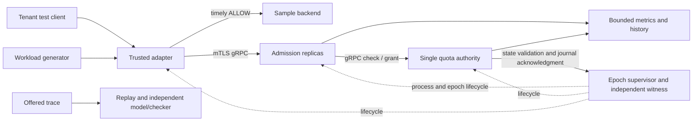
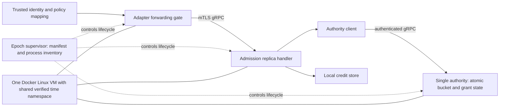
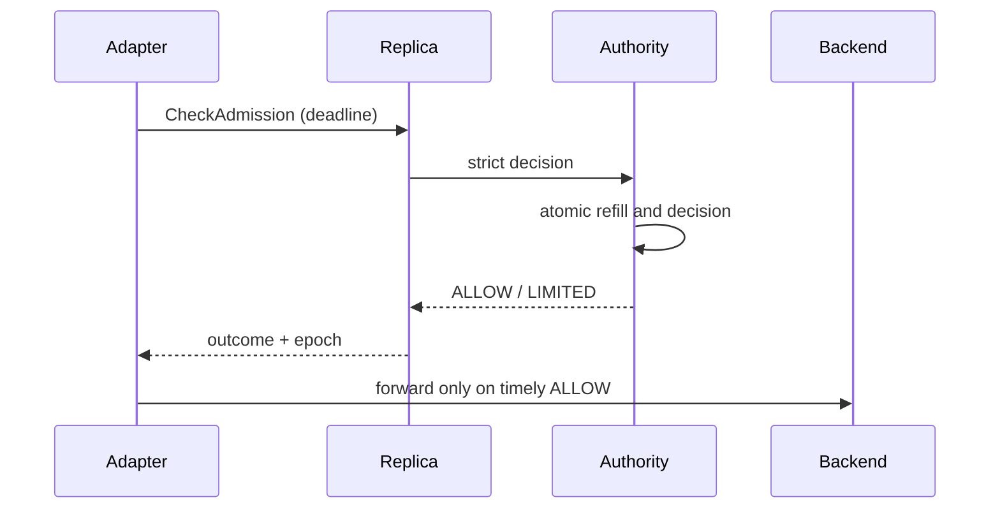

# DistributedRateGuard — High-Level Design

**Revision:** 2 · **Date:** 2026-11-04 · **Status:** Proposed; not implemented or verified  
**Sources:** [PRD revision 6](PRD.md) and [SRD revision 3](SRD.md), read from main.

## 1. Purpose, scope, and decision status

Backend and platform engineers need per-tenant admission decisions across replicas and reproducible evidence of the coordination/accuracy trade-off. Release A supplies strict atomic quota decisions; B supplies replay and evaluation; C supplies fixed-batch distributed credits and formal evidence. PRD-013 live policy changes and PRD-014 long-operation permits are deferred. Multi-host operation, automatic authority failover, production availability claims, and seamless cross-epoch quota continuity are excluded.

Accepted SRD D1–D9 and D11 are requirements. This HLD proposes a single C++ authority process with in-memory epoch state and a supervisor-owned state witness and durable epoch manifest. The prototype must establish whether this design can meet state-integrity, fencing and measurement obligations. No performance or safety result is claimed.

## 2. Drivers and quality attributes

| Driver | Contract | Architectural implication |
| --- | --- | --- |
| Per-tenant atomic budget, weighted costs | PRD-001–004; FR-002–004 | One logical authority serializes each tenant's updates; local credit spending has separate atomicity. |
| Deadline, unknown commit and failure | PRD-005/007/008/024; FR-006–008 | Timely ALLOW gates forwarding; uncertain spends are never refunded; all old spenders must be fenced before reset. |
| Latency and healthy responses | PRD-011/022; NFR-003/009 | Minimize check-path hops; measure p99 and all terminal/error denominators. Thresholds are targets. |
| Reproducibility and independent safety evidence | PRD-006/010–012/023; FR-011–013/021 | Freeze offered trace and configuration; independent model, checker, fault histories and seeded counterexamples. |
| Coordination savings with bounded burst | PRD-016–020; FR-014–019 | Fixed-Q grants reduce authority calls with an explicit B+rΔt+NQ envelope and stranded-credit cost. |

## 3. Context and components





The adapter is the trust boundary: untrusted client values never determine tenant, operation or cost. The adapter is separate to model a real integration. Replicas are separate processes to exercise concurrency and partition behavior. One authority owns all quota state and is deliberately a single point of failure. The supervisor controls lifecycle; generator, backend, offline replay and checker are independent processes, outside the quota path. No Redis, database, message queue or consensus service is selected.

## 4. Request and failure flows

### Strict admission (A)

1. A trusted adapter authenticates the upstream synthetic context, maps it to an allowed tenant/operation, and sends a deadline-bounded request over mTLS.
2. A ready replica checks epoch/digest, identity, policy, deadline and bounded resources; cost comes from the immutable policy.
3. The authority serializes the tenant transition, samples the common monotonic clock at its actual linearization point, refills with D3 arithmetic and atomically returns ALLOW with a debit or LIMITED without one.
4. The adapter forwards at most once only after receiving ALLOW within its deadline and active epoch. It returns distinct quota, validation and dependency outcomes.



Before observed deadline expiry at commit, no spend may occur. A timeout racing with commit can conceal a debit: the adapter does not forward, refund, or infer the result. A late ALLOW is ignored. An application retry is a new chargeable attempt; a correlation ID does not deduplicate it. Authority disconnect returns UNAVAILABLE rather than quota exhaustion.

### Credit admission (C)

1. A replica atomically spends from its confirmed local batch if enough remains. Otherwise it permanently retires the insufficient remainder.
2. The replica requests a grant for tenant, fixed slot/incarnation, epoch, digest, sequence and triggering cost; it has at most one grant in flight.
3. Authority atomically records a grant and sequence result with the debit: Q if available, otherwise floor(available) if it covers cost, else LIMITED with no debit.
4. Duplicate sequence calls replay the identical recorded result, including LIMITED after refill. A known result permits the next sequence; an unknown result permits only retry of the same sequence.
5. Only confirmed credits may be activated and spent. A partitioned replica can spend confirmed balance within its current epoch but cannot mint or obtain new credit. Crash or retired units are never refunded.

```mermaid
sequenceDiagram
 participant R as Replica
 participant Q as Authority
 R->>Q: AcquireCredit(sequence k)
 Q->>Q: atomic debit + persist result in epoch state
 Q--xR: response lost
 R->>Q: retry sequence k
 Q-->>R: identical recorded result
 R->>R: activate once; atomic local spend
```

## 5. State, consistency, and lifecycle

| State | Owner and consistency | Lifetime / failure |
| --- | --- | --- |
| Bucket balance, refill time | Authority; atomic serialized tenant transition, D3 fixed-point units and checked intermediates | Volatile for a single epoch; authority crash ends epoch. |
| Grant sequence and last result | Authority; debit and result written in one tenant/slot atomic transition | Volatile epoch state; duplicate replay only while epoch is active. Sequence never wraps. |
| Confirmed grant, local remaining, pending sequence | Replica; atomic per-tenant local spend | Bounded one batch/tenant/slot; crash strands balance. |
| Identity mapping, policy and digest | Immutable epoch configuration; adapter and authority validate digest | Fixed within epoch; unknown identities allocate no state. |
| Independent witness image/journal | Supervisor-owned, versioned before/after validation and durable acknowledgment | A-01; failure stops new authority work, no same-epoch recovery |
| Epoch/boot/clock identity and inventory | Supervisor; durable independently preserved manifest, atomic replacement and flush proposed | Missing, mismatched or rollback-suspect data stops activation; independent witness protocol A-01; validation evidence pending. |
| Offered trace, histories and reports | Evaluation tools, versioned schema, hashes and bounded output | Synthetic data; D7 retention and deletion; no unbounded identifier labels. |

**Reviewed architecture decision A-01:** The authority keeps its hot state in memory, with an independently owned supervisor witness. Before every tenant transition or cached grant response, a bounded witness exchange compares the complete current tenant state/version and all fixed-slot grant records with the supervisor-owned expected image. Missing, older, or mismatched records fail closed. The authority reserves the tenant, commits a transition at the shared monotonic timestamp, and sends a versioned before/after record to the witness. It returns a usable result only after the witness records and acknowledges that exact transition. Until acknowledgment, that tenant admits no later transition. A lost acknowledgment retries the identical transition ID; an unavailable witness stops new authority work. Local confirmed credits remain governed by the partition contract.

The witness appends an ordered hash-chained journal, with flush before acknowledgment, and retains an independent expected-state image. A complete checkpoint contains policy, epoch and every tenant/slot state; no eviction or reconstruction of missing live state is allowed. Checkpoint creation is an offline stopped-epoch operation. Journal cap is a proposed 2 GiB per epoch; reaching it stops new authority transitions and triggers fenced shutdown. This is separate from the 1 GiB correctness-history cap. A single writer may batch flushes without acknowledging an unflushed transition. No same-epoch recovery or automatic replay is introduced.

The witness detects declared single-record deletion, version rollback and inconsistent grant results before subsequent authority use. It is not a claim to detect coordinated corruption of both independent images or malicious rollback of the whole host; such evidence is UNKNOWN. Witness/supervisor loss terminates the authority incarnation and blocks reset until all old processes are confirmed stopped. Crash-window, acknowledgment-loss, journal corruption and record-rollback checks are mandatory evidence before this mechanism can satisfy FR-008/AT-09. Added coordination and flush cost may miss performance gates; thresholds must not be reduced to conceal it.

The strict envelope is B+rΔt. Credit spends obey the conservative B+rΔt+NQ bound only within one epoch and on the validated shared clock. Unverified clock provenance makes the real-time result UNKNOWN, never PASS. New epoch initialization may restore B; no continuous cross-epoch envelope is promised.

## 6. Epoch creation, fencing, and recovery

The supervisor owns a fixed inventory of containers and slots, disables automatic restart, and records epoch ID, authority incarnation, boot ID, time namespace, clock ID and policy digest. Startup validates common clock provenance, config, mTLS identities, complete tenant state, slot registrations and authority identity before replicas or adapter become ready. An untrusted client cannot create tenant state.

On authority crash, state-integrity failure or identity change, the epoch becomes terminal. Stop ingress, stop every adapter and replica including isolated credit holders, and obtain positive exit/fencing evidence for every inventory entry. Close old channels, persist a fresh epoch identity and initialize fresh authority state, then start authority, replicas and adapter in order. If any participant cannot be proven stopped, new activation remains unavailable. Stopping only the adapter does not prevent an isolated replica from committing local spends.

A strict replica restart may rejoin only if SRD restart conditions and intact authority state are verified; a credit replica cannot reuse its old slot in the epoch. Adapter restart must not introduce a second forward for an attempt; exact idempotence evidence is an LLD decision. Clock mismatch blocks readiness. Transparent promotion or restoration of an old epoch is unsupported.

**A-03 — lifecycle recovery:** One supervisor holds an exclusive local runtime lock and durably records exact container IDs, boot identity and PID start identities before launching each participant. No participant is unregistered or automatically restarted. Confirm stop with runtime inspect plus OS exit evidence for the recorded identity; a reused PID or an absent response is not proof. Supervisor death does not permit a new supervisor to resume service: recovery loads the last inventory, fences/stops every recorded participant including the old authority and witness, confirms exit, then creates a new epoch. On host reboot, verified changed kernel boot identity proves old kernel processes cannot survive, but the supervisor still inventories/stops any newly auto-started containers before activation. Unreadable or untrusted inventory blocks reset until a controlled complete VM shutdown provides positive fencing evidence. A stop command is monotonic and idempotent by operation ID; activation is never inferred from a partially written manifest.

## 7. Security and trust

**Reviewed decision A-02 — service identity:** Use a local epoch-scoped CA and separate leaf/key per process. URI SAN roles are `spiffe://rateguard.local/adapter/<id>`, `.../replica/<slot>/<incarnation>` and `.../authority/<incarnation>`; the epoch manifest binds each registered identity to its role and policy permissions. Server leafs require serverAuth, clients clientAuth; verify chain, exact expected server SAN, client role, validity and manifest allowlist. Authority checks require authenticated replica roles bound to their slot; adapter principals cannot acquire credits. Witness control uses a supervisor-owned local Unix socket with OS peer credentials bound to the authority inventory entry, not an arbitrary caller-supplied PID.

Provision keys outside the repo with owner-only permissions and read-only process mounts. Disable automatic gRPC application retries/hedging; grant retries are managed explicitly by sequence. Every RPC, including a reused connection, rechecks peer authorization and certificate validity using trusted system wall time; wall time never refills quota. Reject calls when wall-clock trust is lost or a leaf expires; do not let an established channel bypass expiry. Certificate rotation/revocation means closing old channels and starting a fenced new epoch with a rebuilt trust registry. No online revocation or live rotation is claimed. Never export private keys, credentials or full certificates in run artifacts. Proposed negative fixtures cover wrong role/SAN/EKU, expiry on a reused channel, stale epoch leaf and forged tenant headers.

## 8. Deployment and operations

Run all admission and authority processes in one Docker Linux VM, sharing and validating the same kernel time namespace; a macOS generator may run outside because server commit timestamps determine the bound. Health indicates process liveness; readiness additionally checks epoch, authority, policy, clock, principal and slot. The supervisor controls start/stop and refuses unsafe restart.

D6 caps: 10,000 configured tenants, eight replica slots, 1,024 pending checks/replica, 16 KiB request payload, 20 ms authority wait capped by caller deadline, and 1 GiB correctness history/run. Invalid or oversized inputs are rejected; queue saturation returns OVERLOADED; dependency wait expiry returns UNAVAILABLE/unknown as appropriate. A history cap invalidates the correctness run instead of silently dropping evidence. Unknown tenants cannot allocate state. D7 limits exported synthetic local histories to seven days and cleanup on next tool startup/run; published synthetic artifacts are versioned.

## 9. Capacity and evaluation

These are workload calculations, not benchmark results. At 5,000 offered checks/s, a 60 s run schedules 300,000 checks and 30 s warmup schedules 150,000. At 90% cost-1 and 10% cost-5, expected mean is 1.4 units/check, or 7,000 units/s; 1,000 evenly assigned tenants average 5 checks/s and 7 units/s each against r=100 units/s, B=100. This primarily measures service overhead, not sustained quota saturation.

Run open-loop with no retries: five 60 s measurements after 30 s warmup, three replicas, 1,000 tenants and 50 ms deadline. Each run requires p99 completed decision latency ≤5 ms, ≥99% delivered attempts timely ALLOW/LIMITED, and ≥99.5% scheduled arrivals delivered; errors/timeouts fail the terminal-response numerator. Publish scheduled/delivered/missed, per-outcome counts, p50/p95/p99, CPU/memory, raw data and manifest.

For tenant service, two tenants each offer 50 cost-1 attempts/s and a third offers 1,000/s, each r=B=100. Both conforming tenants require ≥99% timely ALLOW per run below the measured capacity knee. For credit efficiency compare identical offered traces, policy, routing, resources, deadlines and instrumentation; five-run median authority operations per 1,000 admitted cost units must fall ≥50%, preserve ≥95% of strict admitted cost and meet latency/service gates. Report bytes, unused/retired/stranded ranges, per-run results and burst deviation. N=1/3/8 and clamped Q sweep are sensitivity experiments; N=3 and Q=clamp(ceil(B/8),max_cost,B) is the fixed pass configuration. At least 1 million decision attempts per mode are required for correctness with seeded-defect detection, separate from performance runs. Two clean pinned reproductions must recalculate results.

**Conflict HLD-03:** SRD D8's deterministic replica routing assigns batches of 1,000 consecutive requests to one replica, while NFR-003 describes uniform routing. Aggregate equality does not ensure uniform short-window traffic. Freeze a corrected or explicitly interpreted trace only after PRD/SRD clarification; do not silently change the contract or certify the gate. Prototype clock-at-commit feasibility, throughput, p99, memory at caps, capacity knee, scheduler delivery and trace recording overhead before freezing the host manifest.

Measure every attempted authority check/grant RPC, including retries and failures, not just unique successful grants. Report witness calls, journal records/bytes, flushes and wait time separately plus total coordination traffic, so batching cannot hide work moved to the supervisor. Freeze exact metric definitions in the manifest before comparison; never exclude retries from the efficiency accounting.

## 10. Alternatives and decision records

| Decision / driver | Proposed choice and benefit | Alternative, cost and revisit condition |
| --- | --- | --- |
| Authority storage, FR-002/008 | In-memory serialized authority, epoch-scoped, simple atomic state | Durable store adds I/O and recovery semantics; reconsider if integrity witness or measured performance requires it. A-01 adds witness/journal overhead; measure before acceptance. |
| Replication, PRD-007 | One authority, explicit stop on failure | Consensus replication adds continuity but needs new failover product contract; reconsider for an availability goal. |
| Time, D4 | Shared Linux monotonic clock, provenance checked | Bounded cross-host uncertainty widens the envelope and needs new scope; reconsider for multi-host deployment. |
| Credits, PRD-016–020 | Fixed Q, one batch per slot, clear bound | Dynamic grants may reduce waste but require PRD change and fair baseline. |
| Fencing, D5 | Supervisor confirms every old process exit | Leases/consensus add timing assumptions; reconsider only with revised availability scope. |
| Replica state, FR-018 | Volatile credits; crashes strand capacity | Durable local journal may narrow stranded ranges but adds write-path cost; reconsider after measurements and contract review. |

**A-04 — commit, evidence and forwarding:** A tenant transition has an exclusive logical reservation across witness operations, without holding a C++ mutex over RPC or file I/O. Capture pre-state under lock, release it for witness validation, reacquire and verify the same reserved version before computing/committing; all other operations for this tenant wait with bounded deadlines. Sample CLOCK_MONOTONIC inside the serialized transition. The timestamp defines the logical state change; witness flush/ack determines whether a successful result can be delivered. If the witness fails after the transition, retain the possible debit as uncertain and terminate the epoch; do not roll back and resume. Duplicate transition records replay without another debit.

For local credits, inspect/retire/check at the same protected point as the clock sample and subtraction. A process pause or deadline expiry after this point can conceal a commit but never makes a late ALLOW usable. Allocate bounded event slots before spending; recording includes reserved/published state so a torn/unpublished event is visibly incomplete. Shared run buffers may survive an individual process crash but are not host-crash durability. Exact post-crash accounting requires complete verified durable export; otherwise report ranges/UNKNOWN.

Adapter forwarding uses one Pending→ForwardStarted compare-and-swap, conditioned on receipt before deadline and locally active epoch. Each application retry gets a new attempt ID. On adapter crash, do not replay old pending/forward-started attempts. Backend invocation may remain uncertain; no exactly-once backend execution guarantee is claimed. Fencing stops every old replica, so stale local credits cannot survive into a fresh epoch.

**A-05 — interface clarity:** CheckAdmission ALLOW authorizes a timely forward; AcquireCredit GRANTED only allocates credit. They use separate outcome enums. Structured UNAVAILABLE/OVERLOADED use explicit application outcomes; predecode transport errors cannot imply quota denial. [LLD §4](LLD.md#4-interfaces-and-outcome-mapping) defines wire fields and canonical encoding.

## 11. Observability and diagnosis

Generator owns offered events; authority owns strict commits and grant charges; replica owns local spend and responses; adapter owns receipt and forwarding; backend owns completion. Bounded correctness histories carry immutable attempt and grant IDs, commit time, epoch and outcome. At quiescence reconcile completed ⊆ forwarded ⊆ timely received ALLOW ⊆ committed ALLOW; committed may exceed responded when responses are lost. LIMITED has no debit. Match grant charges to consumed, remaining, retired and stranded credit. After a crash with incomplete spend evidence report a conservative range, not an invented exact amount.

Publish aggregate outcome counts, pending/overload, latency, authority calls and bytes, credit accounting, trace/manifest hashes and run validity. Tenant, grant and correlation IDs are not metric labels. Offline replay uses complete offered attempts, immutable policies, initial state, explicit tie order and independent model; reject malformed or incomplete traces.

## 12. Requirement traceability

| PRD | SRD / owner | Mechanism and planned evidence |
| --- | --- | --- |
| 001–003 | FR-001–003, NFR-001 / authority | Atomic tenant state, D3, AT-01–04/21. |
| 004–005 | FR-004–006, NFR-002 / adapter, authority | Separate quotas, outcomes and deadlines; AT-05–07/22. |
| 006 | FR-011–012 / replay | Independent complete trace comparison; AT-12. |
| 007–008 | FR-001/003/007–008 / supervisor, authority | Epoch/identity checks and failures; AT-01/04/08–09; A-01/A-02 require implementation evidence. |
| 009 | FR-009 / all event owners | Bounded stage events and reconciliation; AT-10. |
| 010–012 | FR-013, NFR-003/006/007 / evaluation | Frozen runs, p99 and clean reproductions; AT-13/23/25; HLD-03. |
| 013–014 | Deferred | Live policy changes and long-operation permits require new contracts. |
| 015 | FR-008/010, NFR-008 / supervisor, replica | Finite caps and fail-closed state; AT-09/11. |
| 016–019 | FR-014–018, NFR-001 / authority, replica, supervisor | Fixed slots, atomic grants/spends and fencing; AT-14–18/21; A-01. |
| 020 | FR-019, NFR-003–005 / evaluation | Paired efficiency and admitted-cost measurements; AT-19/23–24. |
| 021/023 | FR-020–021 / model and checker | Independent state machine and implementation-trace checking; AT-20/26. |
| 022 | NFR-009 / generator, adapter | ≥99% timely non-error outcomes; AT-27. |
| 024 | FR-001/003/008/017 / supervisor, adapter | Clock provenance, identity and positive fencing; AT-01/04/09/17/18; A-01/A-02. |

## 13. Principal review and remaining gates

HLD revision 2 and [LLD revision 3](LLD.md) incorporate the following architecture decisions. “Resolved in design” does not mean implemented, measured or verified.

| Finding | Principal review disposition |
| --- | --- |
| HLD-01 / LLD-01: state integrity | Design mechanism selected in A-01: independent supervisor witness, pre-state validation, versioned journal and acknowledgment barrier. Missing/corrupt witness fails closed; implementation/fault evidence pending. |
| HLD-02 / LLD-02: internal identity | A-02 fixes roles, endpoint SAN checks, local provisioning, per-RPC expiry and fenced epoch rotation. Negative certificate evidence pending. |
| HLD-03 / LLD-03: routing | Source clarification remains required: preserve exact D8 batched trace, report per-window skew, do not relabel it short-window uniform or certify disputed NFR-003. Requirements owner chooses source wording; no threshold is changed here. |
| HLD-04 / LLD-07: time | A-04 locates logical timestamps within reserved serialized transitions, separates durability acknowledgment, and preserves unknown results. Kernel/protocol validation pending. |
| HLD-05 / LLD-06: supervisor recovery | A-03 requires exact inventory/OS exit evidence, prohibits adopting a running epoch after supervisor loss, and blocks unknown processes. Crash-recovery evidence pending. |
| HLD-06 / LLD-04/05: wire/events/forwarding | A-04/A-05 define bounded precommit event reservations, incomplete-history verdicts, forwarding CAS, explicit outcomes and versioned fields/encoding. No exact host-crash accounting claim. |
| LLD-08: epoch-terminal wording | Source clarification remains required: distinguish authority-terminal notification from fully fenced epoch closure. Isolated confirmed credits may still spend in the old epoch until stopped; no fresh epoch can overlap. Product owner must resolve any stronger immediate-stop interpretation. |
| HLD-07: operating targets | All gates retained. Witness RPC/journal flush cost is measured, not assumed to fit 5 ms. No optional cheaper path may bypass integrity to pass benchmarks. |

Before affected code generation, produce schema golden vectors, witness transaction/fail-stop fixtures, process-fencing and certificate fixtures, and shared-clock transition evidence against the recorded contracts. Before gate certification, resolve source routing and epoch-terminal wording with PRD/SRD owners. All PRD/SRD numerical gates, release order and deferred items are preserved. Authority/witness remains a single availability failure domain; no transparent failover or cross-epoch envelope is introduced.

No implementation, benchmark, model proof or production-readiness claim follows from this review. See [principal review record](reviews/principal-design-review-2026-11-04.md) for finding-by-finding evidence obligations.
