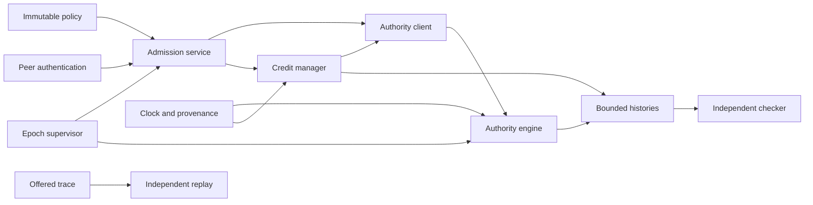

# DistributedRateGuard — Low-Level Design

**Revision:** 2 · **Date:** 2026-11-04 · **Status:** Proposed design; implementation/evidence pending  
**Review branch:** `docs/lld-contract-review-v2`, created from `main`  
**Binding sources:** [PRD revision 6](PRD.md), [SRD revision 3](SRD.md)  
**Architecture input:** [proposed HLD revision 1](https://github.com/kshiteesh28/DistributedRateGuard/blob/docs/hld-design-review-v2/docs/HLD.md). HLD is not present on main at the time of this design.  
**Source blob identities:** PRD `04456d95ed2474700198361db2314c50a73cb300`; SRD `dd82770809e1a56900336070404360c33b3b08a2`; HLD `fb835c70b4d53f1f4bf980dde1f0cd3065212cf3`.

## 1. Scope and implementation status

This LLD serves implementers and reviewers of a tenant admission service. A delivers strict quota decisions, B delivers deterministic replay and evaluation, and C delivers fixed-Q credits and independent model/history validation. PRD-013 live policy changes and PRD-014 long-operation permits remain deferred. Multi-host operation, transparent failover, automatic credit reclamation, and continuous cross-epoch quota guarantees are excluded.

The repository root inspected on main contains README and docs; all implementation paths below are proposed. There is no established build layout to preserve. PRD/SRD are binding; SRD §8 explicitly supersedes historical open decisions. The HLD's in-memory authority is a proposal conditional on integrity/fencing decisions. This LLD proposes interfaces and synchronization; §15 lists implementation gates rather than silently resolving product behavior. No code, tests, model checks, benchmarks, or deployment are claimed.

## 2. Modules and dependency graph

All paths in this table are **proposed**. Public means a process boundary; internal means a C++ library boundary.

| Module/path | Boundary; dependencies | State owned; source |
| --- | --- | --- |
| `proto/rateguard/v1/*.proto` | Public gRPC, Protocol Buffers | Versioned wire contract; FR-005/015 |
| `src/policy/` | Internal; digest/codec | Immutable policy/authorization snapshot; FR-001/003 |
| `src/platform/clock_linux.*` | Internal Linux API | Clock provenance; D3/D4, PRD-024 |
| `src/security/` | Public peer identity + internal resolver; gRPC TLS | Authorized principals, synthetic tenant/operation bindings; FR-003 |
| `src/admission/` | Public CheckAdmission; policy, authority client, credits | Bounded in-flight calls; FR-005/006/010 |
| `src/authority/` | Internal strict/grant engine plus internal gRPC | Buckets, grant journal, tenant transition order; FR-002/015 |
| `src/credits/` | Internal; authority client, clock | Fixed-slot confirmed credit and pending sequence; FR-014–018 |
| `src/supervisor/` | Local CLI/control protocol; process controller, manifest | Inventory, epoch lifecycle; FR-001/007/008 |
| `adapter/` | Public sample API; admission client | Forwarding attempt state; FR-006 |
| `src/events/` | Internal; bounded recorder/export | Event buffers and bounded aggregate metrics; FR-009 |
| `tools/loadgen/`, `tools/report/` | Offline CLI; traces and manifest | Schedule, paired samples, gate calculations; FR-013/019 |
| `tools/replay/` | Offline CLI; independent arithmetic/model | Comparison output; FR-011/012 |
| `model/`, `tools/history_checker/` | Offline; event schema only | Explored model states and counterexamples; FR-021 |

Proposed C++ libraries own state using RAII; configuration snapshots use immutable shared ownership; tenant/slot state has process lifetime and is never evicted during an epoch. Requests own buffers, cancellation tokens and bounded event reservations. Background threads use joined shutdown, not detached access to destroyed state. gRPC/protobuf are required; crypto hashing support and test/model tooling versions must be pinned before build work. No additional storage service or queue is selected.



## 3. Types, ownership, units and lifetime

Illustrative domain declarations below are design notation, not compiling production interfaces.

```cpp
struct CheckInput { TrustedPrincipal principal; TenantId tenant;
  OperationId operation; AttemptId attempt; EpochId epoch; Deadline deadline; };
struct GrantInput { TenantId tenant; SlotId slot; Incarnation incarnation;
  EpochId epoch; PolicyDigest digest; uint64_t sequence; Units trigger_cost; };
struct Bucket { uint64_t balance_subunits; uint64_t last_refill_ns;
  uint64_t transition_order; };
enum class Outcome { Allow, Limited, Invalid, Unauthenticated,
                     Unavailable, Overloaded };
struct Decision { Outcome outcome; EpochId epoch; PolicyDigest digest;
  Mode mode; AttemptId attempt; OptionalDuration retry_after; };
```

TrustedPrincipal is constructed only from validated transport identity, never deserialized from an untrusted override. Tenant/operation selectors are accepted only against immutable principal authorization; cost/rate/mode come from policy.

| Type/state | Validation; mutation/owner | Lifetime, serialization and reuse |
| --- | --- | --- |
| TenantId / OperationId | Exact configured identifier, bounded by message/config limits; immutable policy | Epoch; serialized in authorized request/history; no lazy creation |
| Principal | Registered URI SAN, role and permitted pair; security resolver | Connection + epoch snapshot; log pseudonym only |
| PolicyDigest | Proposed SHA-256 of canonical validated policy; immutable | Manifest/wire/artifacts; digest encoding gate LLD-04 |
| EpochId | Supervisor-generated unique value, never reused; immutable | Manifest, every result/event |
| SlotId / incarnation | Registered fixed slot ≤8; exact incarnation match | One epoch; no credit-slot reuse after restart |
| AttemptId | Adapter-generated unique attempt identity; duplicate active IDs rejected by adapter | Wire/history; no idempotency/refund semantics; new application retry uses new ID |
| GrantId / sequence | Unique within epoch, tuple binds tenant/slot/incarnation/sequence | Last result per tenant/slot; uint64 starts 1, no wrap |
| Units / subunits | Positive integer input units, internal 10^9 subunits/unit | Wire uses explicit units; state stores subunits |
| Deadline / commit time | Trusted service deadline conversion; monotonic ns at commit | Request lifetime/history; caller timestamps cannot mint refill |
| Bucket | balance≤B×10^9, time nondecreasing, ordered transitions | Authority memory; no same-epoch reconstruction after loss |
| Pending grant | Exact input fingerprint, sequence, pending/unknown status | Replica epoch; one per tenant/slot |
| Confirmed credit | Grant provenance, activated once, remaining≤grant | Replica memory; no transfer, refund, or resurrection |
| Retired / unresolved | Monotonic accounting counters and pending identity | History; unknown outcome is not zero spend |
| Event / checker result | Version, epoch, owner/order, timestamp, complete flag | Export; verdict PASS/FAIL/UNKNOWN plus provenance |
| Manifest / replay input | Version, validated policy and identity/provenance hashes | Durable file / versioned artifact; no silent field defaults |

Numeric bounds from D3: 1≤B,r≤10^9; 1≤c≤B; max_cost≤Q≤B. B_sub=B×10^9≤10^18 fits uint64. Let S=10^9 subunits/unit and T=10^9 ns/s:
`refill_sub = r(unit/s) × elapsed(ns) × S/T = r × elapsed`.
Compute product and sum in checked unsigned 128-bit, cap at B_sub, then narrow. No floating-point enforcement arithmetic. floor(available_sub/S) gives whole grant units; fractional bucket balance stays at authority. Never round grants upward. Sequence max is usable once; after its recorded result no next grant sequence exists.

Examples for independent golden tests: B=r=c=1, balance=0, elapsed=1 ns adds 1 subunit and cannot admit one unit; elapsed=10^9 ns adds 10^9 subunits and admits exactly one. B=r=10^9, balance=0, elapsed=10^9 ns yields 10^18 subunits. B=3,r=2,balance=2 units,elapsed=1 s caps at 3; cost 3 then leaves zero. available=5S−1 cannot admit c=5. Rate/B=10^9+1 or c=0 rejects policy/input without mutation. Checked arithmetic failure never wraps: stop affected enforcement and report integrity failure. Product at legal uint64 elapsed remains below 2^128; overflow guard is still required before conversion/addition and malformed-range inputs are rejected.

## 4. Interfaces and outcome mapping

Proposed signatures express lifetime and cancellation; wire field numbers remain LLD-04.

```cpp
Result<Decision, ServiceError> CheckAdmission(
    const CheckInput&, const CancellationToken&);
Result<GrantResult, ServiceError> AcquireCredit(
    const AuthorizedReplica&, const GrantInput&, Deadline,
    const CancellationToken&);
ReadinessSnapshot Readiness(); // liveness is separate
ControlResult StartEpoch(const SupervisorCommand&);
ControlResult StopEpoch(const SupervisorCommand&);
ExportResult ExportHistory(const ExportSpec&);
ReplayReport Replay(const CompleteTrace&, const PolicyPair&);
CheckReport ValidateHistory(const CompleteHistory&, const ModelConfig&);
```

Common validation order: transport identity/role → bounded request decoding → active epoch/digest/incarnation → configured authorization/policy → numeric/sequence syntax → queue/deadline → state transition. Invalid input never creates quota state. Transport failures may occur before a structured response exists. Data RPCs cap at 16 KiB and pending checks at 1,024/replica. Offline exports/inputs stream under explicit run size limits; they do not pretend to fit one data RPC.

| Interface | Caller, input/output; commit | Deadline, retry and emitted record |
| --- | --- | --- |
| CheckAdmission | Adapter role; trusted selector, operation, attempt, deadline → outcome/epoch/digest/mode/correlation and advisory delay. Strict authority debit or local spend commits. | Expiry observed precommit: no debit. Lost/late result may conceal debit; application repeat is a new attempt. Offered/response/commit events distinct. |
| AcquireCredit | Replica role bound to slot/incarnation; grant tuple + trigger + deadline → grant or LIMITED plus provenance. Debit+result commit together. | Duplicate current seq returns recorded identical result; stale/skipped rejects; unknown retries same tuple/seq only. Record allocation and replay events separately. |
| Readiness/health | Authenticated operator/local supervisor; readiness snapshot lists epoch/clock/state/authority checks; health only says process alive. | Read-only, bounded poll; safe retry, no quota commit. Partitioned credit replica may serve confirmed units despite inability to obtain grants; publish degraded state. |
| StartEpoch | Supervisor only; fresh identity/policy/provenance/inventory → activation record or blocked reason. | Not complete until all fencing/start checks pass. Retry command ID retrieves operation state; cannot mint second epoch. |
| StopEpoch | Supervisor only; epoch+command ID → quiescing/stopped/unknown inventory. | Timeout means unknown, never stopped. Repeat observes same stop operation. |
| ExportHistory | Local authorized tool; epoch/run + destination → count/hash/complete flag. | Read-only streaming; cap/write failure marks incomplete; retry must not claim missing records recovered. |
| Replay | Local tool; complete trace, initial state, two policies → deterministic decisions/comparison or validation errors. | No enforcement mutation; cancellation yields incomplete result; repeat immutable inputs is safe. |
| ValidateHistory | Local tool; complete events/model bounds → PASS/FAIL/UNKNOWN and counterexample. | Missing clocks/events yields UNKNOWN. Resource exhaustion is not PASS; repeat same model/config reproducible. |

Binding D1/D2 from SRD §8: invalid→INVALID_ARGUMENT, unauthenticated→UNAUTHENTICATED, unauthorized→PERMISSION_DENIED; none charge. ALLOW/LIMITED are explicit application outcomes over successful transport. UNAVAILABLE/OVERLOADED are distinct application outcomes when the service can return them. Raw transport UNAVAILABLE/DEADLINE_EXCEEDED/CANCELLED after dispatch leaves commitment uncertain. Exact mappings for structured overload versus transport RESOURCE_EXHAUSTED remain a proposal requiring agreement before schema generation. Earlier SRD sections still mention open D1/D2; §8 supersedes them for the three settled mappings. A late ALLOW cannot authorize forwarding.

## 5. Strict bucket algorithm

Preload every configured tenant at explicit epoch initialization with full B. Request handling uses find-only lookup. Validate canonical policy digest at startup and compare immutable snapshot identity, not untrusted request cost. Each tenant has a stable owning object with a mutex; no request inserts/evicts entries. Only one supervisor-registered authority incarnation serves an epoch. Local locks give no safety across two authority processes.

Illustrative pseudocode; proposed event reservation fails before spend if correctness evidence cannot be bounded:

```text
validate request, authorization, policy, epoch
reserve bounded event space if correctness run enabled
lock tenant
  verify epoch still admitting and record integrity (BLOCKED by LLD-01)
  now := verified CLOCK_MONOTONIC
  if observed deadline expired: exit without mutation
  if now < last_refill: mark integrity failure; exit unavailable
  available := min(B*S, checked128(balance + r*(now-last_refill)))
  if available >= c*S: next := available-c*S; outcome := ALLOW
  else: next := available; outcome := LIMITED
  commit balance, last_refill=now, transition_order++, event slot
unlock tenant
return decision unless transport/deadline makes receipt uncertain
```

Sampling inside the mutex is the proposed logical linearization instant: no observer can see intermediate state; all result-relevant fields transition together. LLD-07 requires a demonstrable mapping between that instant and history timestamps; a timestamp taken at RPC ingress is insufficient. A clock read/system failure stops the transition. LIMITED advances refill time but charges no cost.

Advisory retry for c≤B: if deficit=cS−available>0, delay_ns=ceil(deficit/r), using integer quotient/remainder; this is not a reservation. No refund follows downstream failure. At exactly available=cS admit; at cS−1 deny. Equal timestamps get a monotonic per-tenant order; model tests exercise both event boundaries. On [t0,t1), committed strict cost ≤B+r(t1−t0) within the same epoch. Ledger order validates state transitions, and interval checks independently validate the envelope. Uncertain calls reconcile against ledger events; reject-all mutants must fail eligible serial fixtures.

## 6. Credit algorithm and retry state

Authority record keyed by (tenant,slot) contains incarnation, current sequence, exact request fingerprint, outcome, granted units, grant ID and commit metadata. Retain the last result until the next sequence commits; older sequences reject as stale per SRD. Current-sequence retries with different content reject without debit. This fingerprint rule prevents changing the triggering cost under an idempotency key.

| State/event | Required transition |
| --- | --- |
| EMPTY + attempt | Designate one pending caller/sequence, request grant outside lock |
| ACTIVE + sufficient balance | Atomically spend and record grant-linked commit; remain ACTIVE |
| ACTIVE + insufficient balance | Retire remainder exactly once; enter EMPTY/PENDING |
| PENDING + concurrent attempt | Wait bounded by caller deadline or overload; no second grant |
| PENDING + known grant | Validate tuple, activate once, spend only if triggering caller still eligible |
| PENDING + known LIMITED | Consume sequence, return LIMITED; future new attempt may advance |
| PENDING + lost response | UNKNOWN(seq,input); prohibit next sequence |
| UNKNOWN + retry | Same sequence and fingerprint only; resolve same result |
| Any + epoch/fatal mismatch | STOPPED; never recreate allowance |

Authority grant transition under tenant lock:
```text
authenticate registered replica/slot; validate tuple and trigger
if seq == recorded.seq: return identical result iff fingerprint matches
if seq != expected_next: reject
refill via strict arithmetic at authority linearization point
g := min(Q, floor(available/S))
if g < trigger: result := LIMITED, amount=0
else: result := GRANT(unique tuple-derived id), amount=g
atomically record balance debit (g*S or zero), refill time and result
```

Known LIMITED is replayed after refill; it is not reevaluated under the same sequence. Grant activation verifies full provenance and is protected by a per-tenant replica mutex; duplicate network callbacks cannot activate twice. The sequence coordinator holds no lock across RPC. On grant success after the initiating check deadline, retain the confirmed batch without spending for that expired check; later eligible calls can spend it. A lost grant response stays UNKNOWN, and a subsequent same-sequence resolution cannot turn the expired check into a forward.

Local spend checks epoch, incarnation, deadline and sufficient remaining under one lock, samples the common clock, subtracts cS, and fills pre-reserved event storage. Crash before/after commit may make exact accounting unknowable; no refund. Authority partition permits already confirmed credits, then unavailable after exhaustion. No prefetch, transfer, reclamation or automatic slot replacement.

Conservation: every spent unit belongs to exactly one unique confirmed grant and no unit is spent twice. For one epoch, carried confirmed credits ≤NQ, new grant debits satisfy authority bucket envelope, hence committed cost ≤B+rΔt+NQ. This is a conservative bound, not strict-equivalent behavior. Verify history and common-clock provenance before reporting PASS.

## 7. Synchronization and C++ lifetime rules

| Shared object | Proposed protection, ordering and shutdown |
| --- | --- |
| Immutable policy/identity registry | Publish before readiness, read-only shared ownership. No live replacement within epoch. |
| Tenant table | Fixed indexed collection after startup; stable unique owners, no request-time insert/erase. Exact ID map is immutable. |
| Bucket + tenant grant records | One tenant mutex, covering refill/debit/result/order/event state; unrelated tenants proceed independently. |
| Replica tenant/slot state | One mutex/condition for active batch, coordinator, sequence and local accounting. Network continuation validates generation before applying. |
| Epoch readiness | Atomic gate plus supervisor lifecycle. Authority transition checks under its state synchronization; local credit spends check local gate. Isolated replicas cannot be instantaneously notified. |
| Adapter attempt | Single atomic transition Pending→ForwardStarted or Pending→Expired/Failed. ForwardStarted is never entered twice. No automatic replay after adapter crash. |
| Events/metrics | Preallocated event reservations; fixed atomic counters; bounded exporter. Never invoke external callback while holding tenant lock. |
| Supervisor manifest/inventory | Single owner control thread and exclusive process-control lock; ID-keyed command state. Persistent recovery protocol remains LLD-06. |

No tenant lock is held across RPC, disk I/O, user callbacks, or blocking log export. Acquire configuration snapshot and locate stable tenant before locking; never hold authority and replica locks together. Reserve bounded recorder space before state lock; fill an exclusive reservation inside the transition and publish nonblocking. If reserve fails, do not start commit; if publication/integrity fails after commit, invalidate run, stop affected service and report uncertainty. Event durability on process death remains LLD-05.

Cancellation stops waiting and forwarding; it does not undo a committed debit or grant. Shutdown closes admission gate, wakes waiters, cancels bounded outbound waits, joins all workers, exports/marks incomplete histories and reports process exit. A supervisor timeout cannot substitute for exit confirmation. Race checks target duplicate callbacks, simultaneous local spends, lock acquisition at deadline, stop concurrent with spend, and two simultaneous requests for one grant sequence.

## 8. Manifest, integrity and fencing

Proposed manifest v1 fields: schema version; never-reused epoch ID; mode; canonical policy bytes/digest; authority incarnation; kernel boot and time-namespace identities; clock ID; fixed slot/incarnation bindings; expected tenant IDs/count; supervisor operation ID; container IDs/PID start identities; lifecycle state and activation generation. File permissions: supervisor write-only ownership, participants read-only, secret keys stored separately. Unknown versions or mismatched digests fail startup. Canonical policy proposal is sorted typed records with explicit lengths, UTF-8 identifiers and integer quantities; schema and canonicalization vectors must be agreed in LLD-04. No unspecified JSON serialization order may define a digest.

Proposed write procedure: construct a complete validated temporary file on the same filesystem, write and fsync it, rename atomically, then fsync the directory. This protects against torn replacement; it does not prove rollback absence. Manifest activation/fencing recovery is blocked by LLD-01/06.

Startup: validate complete manifest/policy, clock provenance, registered process identities and unique authority ownership; initialize authority state only during explicit new epoch; validate expected tenant inventory/grant state; start replicas with fixed slots; start adapter last. Readiness stays false until checks pass. Prohibit two supervisors using exclusive OS ownership and exact persisted container IDs; supervisor lock loss stops new activation. A lock alone cannot fence processes after supervisor failure.

Stop/reset: persist quiescing intent, stop ingress, stop adapters and every old replica, wait for OS/container-runtime exited evidence tied to exact container/PID identity, close channels and stop authority, then record terminal epoch. Fresh activation requires a completed inventory, new authority incarnation and new epoch. Unknown/unreachable container, PID reuse, partial shutdown or missing manifest evidence leaves BLOCKED. Host reboot changes boot identity and mandates a new fenced epoch; previous activation cannot resume automatically. Supervisor crash never authorizes adopting a guessed fresh inventory.

**HLD-01 remains blocking:** in-memory bucket/grant state plus a file manifest cannot independently detect live rollback. Candidate options for architecture review:
- independently maintained durable transition witness with checked versions: added I/O/atomicity and shared-failure analysis;
- redundant independently validated state and fail-stop checks: memory/common-mode limits, not automatically durable;
- revised fault contract explicitly limited to detectable failures: changes product requirements and needs owner approval.
No witness is invented here. FR-008/PRD-007/015/024 and AT-09 cannot be declared satisfied by an ordinary map lookup/checksum.

## 9. mTLS and authorization

Proposed handshake validation: trusted local CA chain, validity interval, client/server EKU, endpoint identity and registered URI SAN. Perform role checks before constructing TrustedPrincipal. Adapter authorization is binding D9; internal authority role binding is an LLD proposal pending HLD-02. Proposed replica principal binds exactly epoch slot/incarnation and tenant scope; lifecycle control is local-supervisor-only. Never trust a claimed role/slot in protobuf without peer binding.

Use synthetic upstream fixtures selected by adapter configuration. Ignore forged override headers; reject direct unregistered clients, expired certificates, wrong SAN/role and disallowed tenant/operation with settled D1/D2 codes and no state allocation. Unknown operations yield INVALID_ARGUMENT; authorization failure yields PERMISSION_DENIED. Connection establishment failures produce no application ALLOW.

Proposed test PKI: ephemeral local CA, separate leaf per adapter/replica/authority, generated outside source tree, read-only secret mounts to owners with restrictive permissions. Do not publish private keys, full certificate material, raw tokens or credential-bearing payloads in artifacts. Revocation/rotation needs a stopped epoch and rebuilt immutable trust snapshot; handling expiry on an existing channel requires explicit enforcement policy. **HLD-02 is blocking:** security lead must approve provisioning, SAN grammar, endpoint identity, TLS-library/version behavior, revocation/rotation and existing-connection expiry tests before network implementation. No production PKI claim is made.

## 10. Persistence, journals and telemetry

| Record | Durability/write boundary; failure behavior | Bound/lifetime |
| --- | --- | --- |
| Policy/epoch manifest | Durable supervisor file proposed; failed validation/fsync/rename prevents activation | Finite configured tenants/slots; active manifest plus explicitly retained artifacts |
| Bucket/grant result | Authority volatile epoch state; mutation protected together; missing record stops epoch | 10k tenants × at most 8 last grant results; no same-epoch reconstruction |
| Local confirmed/pending credit | Volatile replica state; atomic spend/activation; crash strands units | One batch and one pending result per configured tenant/slot |
| Correctness event history | Reserved bounded in-memory events then exported; crash may lose unpublished history | Proposed global run budget ≤1 GiB across producers; no per-process multiplication |
| Aggregate metrics | Volatile counters/gauges; exporter failure visible, no quota refund | Fixed labels only; no tenant/grant/attempt/correlation labels |
| Trace/replay/model output | Versioned artifacts with input/output hashes and complete flag; write failure produces incomplete report | Explicit streamed limits, cleanup; no unlimited model output |

Proposed global history budget allocates bounded producer reservations before the run; a consumer cannot allocate beyond its share. If cap/write failure occurs, stop correctness traffic and mark run INCOMPLETE, not PASS. Performance runs omit full histories but retain bounded aggregate metrics and manifest. Any rejection caused by evidence limits is reported, never hidden as quota denial.

Owners and reconciliation: generator OFFERED; authority STRICT_COMMIT/GRANT_COMMIT; replica LOCAL_COMMIT/RESPONDED; adapter RECEIVED/FORWARDED; backend COMPLETED. Every event has schema version, epoch, attempt/grant tuple, monotonic timestamp, component and per-component order, policy digest, outcome and cost when applicable. IDs identify events, not authorization. Separate each application retry's attempt ID; repeated grant RPCs reuse grant sequence and input fingerprint.

At quiescence: completed⊆forwarded⊆timely received ALLOW⊆committed ALLOW; LIMITED has no cost debit. A commit may lack received/responded events. Classify offered attempts as known responded, expired/cancelled, or unresolved. Grant ledger totals reconcile consumed+remaining+retired+stranded, with unresolved allocations separate. Complete durable local history permits exact stranded cost; otherwise report a conservative range [0, granted−last verified consumed−last verified retired], tightened only by sound evidence. Missing grant/clock provenance can make the result UNKNOWN. Never treat zero observed local consumption as proof that credits are unused.

D7: only synthetic/pseudonymized published data, explicit correctness export disabled by default, local artifacts retained seven days with cleanup at next tool startup/run. Published versioned synthetic benchmark artifacts are retained under project control and distinguished from local exports. Cleanup errors are visible; no claim of immediate timed deletion when tools are not running.

## 11. Replay, model and history validation

Proposed artifact schemas, exact encoding gated by LLD-04:
- OfferedTraceV1: initial state, relative arrival_ns, stable row order, tenant, operation, schema/model version, seed, policy hashes, row count and content hash. No historical-admissions-only trace qualifies.
- ReplayReportV1: per-policy row decisions, per-tenant offered/admitted counts/cost, changed decisions, first divergence with explanation, full input/hash provenance.
- HistoryV1: invocation/response and commit/grant/spend/lifecycle events, clock provenance, per-source ordering and completeness/truncation markers.
- ModelConfigV1: N, B/r/Q/cost domains, time/horizon bounds, allowed fault actions, fairness assumptions, expected invariants and tool version.
- CheckReportV1: PASS/FAIL/UNKNOWN, explored bounds/state count or search timeout, invariant, witness/counterexample and deterministic reproduction command.

Replay uses a separate model implementation and exact integer or rational reasoning; production policy decision/arithmetic routines are not imported as the oracle. Run hand-calculated fixtures for equal arrivals, exact eligibility, partial refill, weighted costs, malformed row, unknown policy identity, first divergence and maximum values. Invalid source rows fail rather than disappear.

AT-26 explores valid combinations of two replicas/two tenants, B∈{2,3}, Q∈{1,2}, costs∈{1,2} constrained max_cost≤Q≤B; include retry, loss, crash, partition and epoch actions, with a declared finite time/horizon. Tool choice (e.g. TLA+/TLC plus independent trace checker) is proposed, not an implemented dependency. Archive complete config, state counts, model version and counterexamples. Absence of faults in a bounded model does not establish correctness for all executions.

Concurrent checker: validate schema/complete clock provenance, reconcile ledger events, find a legal per-tenant order respecting completed nonoverlapping calls and committed event order; uncertain calls can be committed/uncommitted only consistently with known ledger. Check all event-induced half-open intervals with tie order and empty-interval conventions; zero-duration empty intervals contain no work, tied timestamps require declared ordering. Missing history or exhausted search budget yields UNKNOWN. Full interval enumeration can be quadratic: use small exhaustive histories for equivalence and a separately validated efficient prefix/envelope checker for million-attempt histories. Do not claim feasible exhaustive state search at that scale without a complexity plan.

Required mutations: double debit/spend, duplicate grant on retry, reject-all, stale epoch reuse, lost-response replacement and violated bound. A reproducible failing history includes seed, minimized schedule where supported, inputs, model/checker versions and affected invariant. Ordinary model/pseudocode is not production code.

## 12. Failure matrix

All rows require no forwarding without timely received ALLOW. Evidence IDs refer to planned SRD checks, not existing tests.

| Trigger / detection | Already committed? | Outcome, retry and forwarding | Event / evidence |
| --- | --- | --- | --- |
| Deadline observed before transition | No | Expiry; no debit; new attempt only if caller chooses | Expired-precommit; AT-07 |
| Deadline races during/after transition | Possible/yes | Unknown or late ALLOW; do not forward/refund | Commit plus expired receipt; AT-07 |
| Strict response lost before commit | Unknown to client | No forward; repeat is new attempt, not deduplication | Unresolved; ledger establishes truth; AT-07/08 |
| Strict response lost after commit | Yes | Same uncertainty; no refund | Committed-unanswered; AT-07 |
| Duplicate current grant | Same recorded result | Replay without debit; activate once | Grant replay; AT-15/21 |
| Stale/skipped or tuple-changed sequence | No new commit | Reject; cannot advance unknown sequence | Validation failure; AT-15 |
| Grant response lost | Possible | UNKNOWN(k), retry exact k/tuple; no replacement | Pending/unresolved allocation; AT-15/18 |
| Credit replica crash | Earlier grants/spends possible | Slot not reused; conservative stranded range; reset requires fencing | Crash/incomplete local history; AT-18 |
| Authority crash | Existing commit possible | Terminal authority incarnation; supervisor stops/reset, no promotion | Epoch terminal/unknown; AT-08/09 |
| Record missing/rollback suspicion | Unknown | Stop before further spend if detectable; witness unresolved | Integrity failure; AT-09; LLD-01 |
| Partition with confirmed credit | Granted earlier | Local eligible spends allowed within old epoch; no new grants | Degraded/local commit; AT-18 |
| Partition without credit | None usable | UNAVAILABLE, not LIMITED unless authority confirmed quota denial | Dependency error; AT-18 |
| Stale epoch/slot process | Possible old credit | Reject new mismatches; do not activate fresh epoch until old process stopped | Fencing evidence; AT-14/18/26 |
| Boot/time namespace mismatch | No new eligible commit | Readiness false, safety UNKNOWN; no bound pass | Provenance failure; AT-01/17 |
| Unknown/expired/wrong-role certificate | No | UNAUTHENTICATED/PERMISSION_DENIED or handshake failure | Bounded auth counter; AT-04 |
| Unknown tenant/operation | No | INVALID/PERMISSION_DENIED per validation boundary; no allocation | Invalid attempt; AT-04 |
| Queue saturation / oversized request | No | OVERLOADED / INVALID or agreed transport mapping | Rejection counts; AT-11 |
| History cap/write failure | Before or after commit | Stop correctness run as incomplete; no refund for past commits | Truncated/incomplete flag; AT-10/11 |
| Supervisor failure during reset | Old processes uncertain | New epoch blocked until complete positive inventory/fence recovery | Control operation state; AT-09 |

**Lifecycle ambiguity LLD-08:** PRD/SRD permit isolated replicas to spend confirmed units during authority disconnect, while accepted D5 calls authority failure terminal. Instant stop of an isolated replica cannot be inferred from authority death. No new epoch starts until it is stopped, and old-epoch events remain accounted. Product/architecture owners must confirm the exact closure/notification semantics before claiming no post-terminal local commits.

## 13. Test seams and requirement traceability

Inject internal ClockSource/ProvenanceProvider, authority port, fault-capable RPC transport, immutable policy fixture, ProcessController, TraceSource and bounded EventRecorder. No public test-only RPC. Failpoints occur before/after authority transition, before response dispatch, before/after local subtraction/event publication, before grant activation and before/after each manifest/fencing step. Fake clock tests deterministic logic; real-kernel provenance and process tests are separate.

| PRD | FR / NFR | Owner, invariant/interface | Planned evidence |
| --- | --- | --- | --- |
| 001 | FR-001; NFR-001 | Supervisor/authority; same policy and budget across replicas | AT-01–03 |
| 002–003 | FR-002/003; NFR-001 | Strict engine/D3, exact permissive bucket decision | AT-02–04/21 |
| 004 | FR-004; NFR-002 | Separate tenant state, noisy-tenant service | AT-05/22 |
| 005 | FR-005/006 | API/adapter, deadlines and forwarding CAS | AT-06/07 |
| 006 | FR-011/012 | Independent replay, complete trace/comparison | AT-12 |
| 007–008 | FR-001/003/007/008 | Lifecycle/identity, no unsafe restart | AT-01/04/08/09 |
| 009 | FR-009 | Event owners and reconciliation | AT-10 |
| 010–012 | FR-013; NFR-003/006/007 | Generator/report, p99 and clean reproductions | AT-13/23/25 |
| 013–014 | Deferred | No live policy or permits | New design required |
| 015 | FR-008/010; NFR-008 | Bounded state and integrity | AT-09/11 |
| 016 | FR-014 | Epoch/slot fixed, no mode mixing | AT-14 |
| 017 | FR-015/016; NFR-001 | Atomic grants and unique local spends | AT-15/16/21 |
| 018 | FR-017; NFR-001 | Provenance and interval bound | AT-17/21 |
| 019 | FR-018 | Unknown/stranded state, no refunds | AT-18 |
| 020 | FR-019; NFR-003–005 | Paired authority-op ratio/admitted cost | AT-19/23/24 |
| 021 | FR-020 | Contract→module→independent checks before generation | AT-20 |
| 022 | NFR-009 | Delivered terminal ALLOW/LIMITED numerator | AT-27 |
| 023 | FR-021 | Independent model/history checker and mutants | AT-26 |
| 024 | FR-001/003/008/017 | Clock identity, authentication, positive fencing | AT-01/04/09/17/18 |

Numerical acceptance remains unchanged: zero observed model/bound violations in ≥1 million attempts per mode with defect detection; noisy-tenant ≥99% timely ALLOW in each of five runs; p99≤5 ms at 5,000 offered checks/s, 1,000 tenants, N=3, 50 ms deadline; ≥99% delivered checks receive timely ALLOW/LIMITED; generator delivery≥99.5%. Credit efficiency requires ≥50% fewer authority operations/1,000 admitted units, ≥95% strict admitted cost, same policy/trace/budget and other gates; compare five-run medians, publish each sample and zero-denominator failure. Two clean pinned reproductions must recalculate results. N=1/3/8 and clamped Q sensitivity are not alternate pass configurations. Correctness/fault histories and performance runs remain separate. No gate is claimed passed.

## 14. Complexity, bounds and ordered increments

Proposed immutable hash ID lookup: average O(1), worst O(T) collision chain; validate finite T≤10,000. Once resolved, bucket and local spend computation are O(1), excluding mutex queueing. Grant-result lookup can use fixed slot array O(1), ≤8 records/tenant. Pending queue wait bounded by deadline and configured count; no worst-case latency is implied by O(1) arithmetic. Replica credit storage O(TN) system-wide ≤80,000 tenant/slot states, with one batch/pending state each. A replica holds ≤1,024 in-flight checks; all eight can hold ≤8,192. Request payload allowance alone can total 128 MiB (8,192×16 KiB); object/transport/TLS overhead is additional and measured before freezing host budget. Histories share ≤1 GiB/run. Configuration key/string lengths and exact memory are part of LLD-04 capacity/schema work.

Replay is O(M) decision work for M sorted offered rows, plus per-tenant aggregates and streamed output; unsorted input is rejected rather than sorted invisibly. Exhaustive ordering/model search is exponential in concurrency/state bounds; pairwise interval enumeration O(M²). Large history validation requires a separate bounded-memory efficient checker verified against the exhaustive small checker. Publish resource-limit UNKNOWN rather than claiming completion.

| Increment / proposed files | Prerequisites, sources | Acceptance and stop condition |
| --- | --- | --- |
| 1 Contract/build: proto, policy, toolchain manifest | LLD-04 mapping/schema; PRD-005/008/021 | Versioned encoding and config golden vectors; missing contracts block network code |
| 2 Pure arithmetic/clock: policy, platform, independent model | D3/D4, PRD-001–003/024 | Boundary/refill/overflow tests AT-01–04; clock provenance prototype LLD-07; arithmetic/model disagreement blocks |
| 3 Lifecycle/identity: supervisor/security/manifest | LLD-01/02/06/08; PRD-007/008/015/024 | Positive fencing and state-fault checks AT-04/08/09/11; unresolved witness blocks serving |
| 4 Strict A: authority/admission/adapter/events | Independent serial oracle, lifecycle/auth and record completeness | AT-01–11/21 and ≥1m attempts; no release A completion on integrity/accounting miss |
| 5 Evaluation B: replay/loadgen/report | Strict baseline, LLD-03 routing resolution and frozen manifest | AT-12/13/22/23/25/27, five runs and two clean reproductions; missed gate remains incomplete |
| 6 Credits C: credits/grant service | Strict correctness, LLD-05/07 event/clock design | AT-14–19/21/24; ≥1m credit attempts, no duplication/refund/unsafe slot reset |
| 7 Formal assurance: model/checker | Stable schema, independently implemented oracle | AT-20/26 seeded mutants and reproducible counterexamples; incomplete search cannot PASS |
| 8 Release evidence review | All applicable source gates | Link requirements→contracts→design→checks→observed results; no threshold adjustment after results |

## 15. Conflicts, owners and review gates

| ID / source | Impact and why unresolved | Options, trade-offs and required owner |
| --- | --- | --- |
| LLD-01 / HLD-01 | FR-008, PRD-007/015/024, AT-09: volatile records cannot independently detect arbitrary rollback via manifest alone | Independent witness vs redundant checked state vs narrower product fault model; architecture + product owner must approve scope/atomicity |
| LLD-02 / HLD-02 | D9/internal gRPC: no settled provisioning, revocation, rotation and existing-channel expiry policy | Epoch-scoped local CA/role leaves vs external identity service; latter expands scope. Security/tech lead approves fixtures, SAN registry and failure evidence |
| LLD-03 / HLD-03 | D8 1,000-request routing batches versus NFR-003 uniform routing makes workload interpretation ambiguous | Preserve batched trace explicitly or revise routing formula to specified short-window uniformity; requirements owner resolves source wording before B/C certification |
| LLD-04 / interface/schema | D1/D2 overload/transport mapping and protobuf compatibility, canonical encoding, identifier maxima, artifact schemas | Proposed explicit outcomes and versioned protobuf; settled INVALID_ARGUMENT/UNAUTHENTICATED/PERMISSION_DENIED retained. API lead approves remaining behavior before code |
| LLD-05 / HLD-06 | FR-009/018: volatile event record and process crash cannot support exact history/accounting | Synchronous durable spend evidence adds I/O; volatile records require UNKNOWN/ranges and run invalidation. Test + architecture lead decides evidence boundary |
| LLD-06 / HLD-05 | FR-001/008: supervisor/host crash and inventory anti-rollback/exclusive ownership | Atomic file plus trusted exit evidence vs stronger lifecycle store; supervisor/architecture lead must specify crash recovery without guessing exit |
| LLD-07 / HLD-04 | FR-002/017: timestamp-at-transition correctness and clock provenance | Logical timestamp within serialized transition needs demonstrable history mapping; platform lead prototypes and documents rounding/order uncertainty |
| LLD-08 / lifecycle wording | Authority failure terminal versus disconnected replicas spending confirmed credits | Define observed closure/fencing semantics, retaining old-epoch accounting, or revise immediate-stop promise. Product/architecture owner resolves before safety assertions |

Review checklist (design review assertions, not executed verification):
- Strict checks and credit local spends have separate mechanisms and distinct per-epoch envelopes.
- No caller timestamp creates refill, no unknown response authorizes forward/refund, no new epoch bypasses old-process fencing.
- Every state object has one owner and synchronization/lifetime rule; witness/event durability remain explicitly gated.
- Every enforcement cap has observable rejection/incomplete behavior; offline schema/resource caps need final encoding review.
- All critical PRD groups and SRD evidence IDs map to a module; no test, throughput, formal proof or production claim is invented.
- Before affected code: resolve LLD-01/02/04–08; before benchmark certification resolve LLD-03; pin dependency/tool versions, host manifest and independent acceptance fixtures. Unaffected pure models/configuration can proceed only after their own contract decisions are resolved.

PRD, SRD and HLD are unchanged by this proposal. The proposed network, persistence, supervisor and history mechanisms remain subject to the recorded gates.
