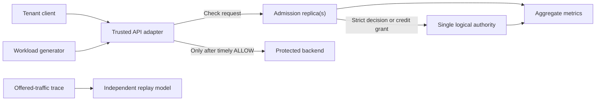

# RateGuard — Software Requirements Document

**Revision:** 2 · **Status:** Draft for review · **Date:** 2026-11-03 · **Source:** [PRD revision 5](PRD.md)  
**Releases:** A — strict core; B — evaluation; C — distributed credits  
**Purpose:** Define observable software behavior and verification obligations. No feature or metric in this document is claimed as implemented.

## 1. System boundary and terminology

RateGuard receives admission requests from a trusted backend adapter before that adapter forwards work. A single logical quota authority owns tenant budget state. Multiple admission replicas serve the same epoch. The authority may be a storage-backed service; the SRD does not select a storage product. A workload generator, reference model, trace replay tool, and metrics exporter support evaluation.



Only a registered, authenticated adapter principal may invoke admission. The adapter, not the untrusted client, determines tenant identity and operation class from trusted server-side context; client headers or request fields cannot override either value. Credential and binding mechanism: D9. The experiment uses synthetic tenants. Network placement alone does not prove authentication. A configured tenant has rate `r` (cost units/second), burst `B` (cost units), and operation costs `c` (positive integer units). An **epoch** fixes mode, policy digest, authority identity, initial balances, replica slots, and the timing convention. A new epoch is a stopped, explicitly initialized run, never a transparent continuation.

**Assumed environment:** one region, one logical authority, static policy, C++ service, gRPC interface, Docker-based local setup. Transparent authority failover, multi-region limits, live policy changes, billing, permits for long-running work, and arbitrary client-created tenants are outside the releases described here.

## 2. Normative interface semantics

The API is specified here at field/meaning level; the final `.proto` encoding and status mapping are blocking decisions D1–D2. Do not infer a successful admission from a transport status alone. Every completed application response has an explicit outcome.

| Operation | Required fields | Result |
| --- | --- | --- |
| `CheckAdmission` | trusted tenant context; configured operation ID; correlation ID; caller deadline | `ALLOW`, `LIMITED`, `INVALID`, `UNAUTHENTICATED`, `UNAVAILABLE`, or `OVERLOADED`; policy digest, mode, epoch, and diagnostic correlation ID where known |
| `AcquireCredit` (C) | tenant, registered replica slot/incarnation, epoch, policy digest, grant sequence, requested units, triggering operation cost, deadline | grant ID, granted units and sequence; or `LIMITED`, `INVALID`, `UNAVAILABLE`, `OVERLOADED` |
| `ReplayPolicies` (B, offline) | complete versioned offered trace, initial state, policies A/B | deterministic per-policy decisions, per-tenant comparison, provenance hashes, and validation errors |

The public adapter translates a received `LIMITED` into HTTP 429 and `UNAVAILABLE`/`OVERLOADED` into HTTP 503 in the sample integration. Other transport mappings, including gRPC status versus application outcome, are fixed by D2. No limit response is returned as 429 when the authority is unreachable. An estimated retry delay means earliest eligibility if no one else consumes the tenant's units under the same policy; it is not a reservation.

An attempt begins when `CheckAdmission` is invoked. A service observing an expired deadline before commit must not commit. Expiry racing with an atomic commit may leave the result uncertain to the caller; any committed spend remains recorded, including committed-but-unforwarded work. In strict mode its **commit** is the atomic authoritative spend. In credit mode its commit is atomic local consumption of a previously confirmed grant; authority allocation is a separate commit. A caller may time out after either commit. The adapter forwards at most once only after receiving `ALLOW` before its own deadline and while the epoch remains active. A late response is ignored. It never refunds because of timeout or downstream failure. An application-level repeat is a new, chargeable attempt; the correlation ID is not a deduplication key.

A valid credit grant sequence is consumed by every known authority result, including `LIMITED`; replaying it returns that same result after refill. The next sequence is allowed only after the previous result is known. Invalid or unauthenticated calls do not consume a sequence. A lost result is resolved by retrying the same sequence. The service must bound pending requests, authority waits, and response payloads. The concrete byte, queue, and time limits are D6. Unauthenticated/unknown-tenant/unknown-operation calls must not create quota state. Client-provided cost, tenant override, or time cannot reduce the configured charge or increase allowance.

## 3. State and mathematical contracts

### 3.1 Strict mode (A)

For tenant `i`, let `B_i > 0`, `r_i > 0`, current balance `b_i ∈ [0,B_i]`, and `Δt ≥ 0` elapsed authority time since the last accounted state. At one atomic decision point:

```text
available_i = min(B_i, b_i + r_i × Δt)
if available_i ≥ c:
    outcome = ALLOW
    next_balance_i = available_i − c
else:
    outcome = LIMITED
    next_balance_i = available_i
```

State may advance refill time on `LIMITED`, but no cost is charged. Decisions for one tenant must admit a sequential history compatible with real-time precedence of nonoverlapping completed calls. For every half-open interval `[t0,t1)` under the declared authority clock and boundary convention, total committed cost must satisfy:

```text
A_i([t0,t1)) ≤ B_i + r_i × (t1 − t0)
```

The interval envelope is necessary, not sufficient: serial eligible requests must be admitted. Calls with equal authority timestamps require a stable authoritative order. Rounding must never mint more credit than the specified reference model. Numeric representation, time units, overflow bounds, and clock-jump behavior are D3–D4. If the authority loses state or its identity changes, serving does not recreate a full bucket.

### 3.2 Distributed credits (C)

At epoch start, fix `N` distinct replica slots and `Q_i` for each tenant with `max_operation_cost_i ≤ Q_i ≤ B_i`. The mode cannot share the same tenant budget with strict admission inside one epoch. A slot is tied to one process incarnation and cannot be reassigned before a quiesced new epoch.

The authority uses the same token-bucket accounting to atomically spend each grant. A grant carries tenant, epoch, slot, incarnation, monotonically increasing sequence, granted units, and a unique grant ID. At most one allocation is in flight per tenant/slot. At most one confirmed batch of up to `Q_i` units is available locally for each tenant/slot; there is no prefetch. For the release-C baseline, the authority grants exactly `Q_i` when available, otherwise exactly `floor(available_i)` integer units when at least the triggering cost `c`; otherwise `LIMITED` without charging. Amount and sequence result are recorded atomically with the bucket debit. D3 fixes integer representation and rounding before implementation. Demand-aware sizing is outside this baseline and requires PRD change control.

A replica atomically consumes `c` local units before returning `ALLOW`. If its remainder cannot pay the triggering cost, it retires and records that remainder before seeking a new grant. Retired units never return to the authority. It must not issue two concurrent grants for the same tenant/slot. The authority persists the current sequence/result for the slot so retrying it returns the same result without a second charge, including a known `LIMITED`; stale or skipped sequences are rejected. A known result permits the next sequence, while an unknown outcome blocks it. A grant is activated once. A timeout with unknown allocation outcome blocks the next sequence until the same sequence is resolved. The concrete sequence width, wraparound policy, and storage durability mechanism are D3/D5.

```mermaid
stateDiagram-v2
    [*] --> Ready
    Ready --> GrantPending: insufficient local units; retire remainder
    GrantPending --> Ready: confirmed unique grant
    GrantPending --> GrantPending: timeout; retry same sequence
    GrantPending --> Unavailable: authority/state integrity lost
    Ready --> Ready: atomically consume units; ALLOW
    Ready --> Limited: no usable units; confirmed quota limit
    Ready --> Unavailable: no usable units; authority unavailable
    Limited --> Ready: later eligible attempt
    Unavailable --> [*]: stopped epoch or explicit recovery
```



**Conservation invariant:** every locally committed unit belongs to exactly one unique confirmed authority grant; a unit cannot be spent twice or transferred to another tenant/epoch. All confirmed, in-flight, retired, and stranded units must be accounted for in the correctness history. For any interval `[t0,t1)` within one epoch with the stated common time interpretation:

```text
A_i([t0,t1)) ≤ B_i + r_i × (t1 − t0) + N × Q_i
```

At most `NQ_i` previously allocated units can be carried into the interval; new grants are bounded by the authority bucket. This is a conservative additional burst allowance, not strict-equivalent admission. The plain real-time bound cannot be reported as verified until D4 defines a common monotonic commit timeline or conservative clock-uncertainty rule. If endpoint timestamps have uncertainty at most `ε`, the external-time check uses `B_i + r_i × (Δt + 2ε) + N × Q_i`; with unbounded `ε`, the real-time result is `UNKNOWN`, never `PASS`. Virtual-time tests may set `ε = 0`. The checker evaluates all intervals induced by commit timestamps, including ties and zero-duration boundaries. A process that crashes strands its units; a timeout is not proof of death and cannot trigger reclamation.

### 3.3 Epoch and failure invariants (A/C)

A replica becomes ready only after verifying matching mode, policy digest, epoch, and authority identity. A restarted strict replica joins the existing state. A restarted credit replica cannot resume or replace an old slot's units unless a separately designed durable local-state protocol exists; v1 requires a new quiesced epoch. No tenant bucket is lazily initialized after loss, eviction, or unknown identity. The only allowed initialization is explicit epoch creation before traffic.

Authority readiness validates an independently preserved epoch identity, expected tenant-state manifest, and grant-result journal consistency. Missing tenant state or a rolled-back sequence stops admission rather than recreating state. Storage and validation mechanisms belong in HLD. When authority connectivity is lost, strict checks without a committed result do not authorize forwarding. A credit replica may spend already confirmed local units but cannot obtain new grants. If authority state disappears, its identity changes, rollback is suspected, or a policy mismatch is observed, new authority commits stop. Already isolated old credit replicas may still have confirmed units. A new epoch requires an activation record identifying every old slot and positive evidence that it stopped or was fenced from admission; an unreachable slot cannot be presumed stopped from a timeout. Without that evidence, the new epoch stays unavailable. D5 selects the mechanism and remains blocking. The exact mechanism is D5 and belongs in HLD.

The PRD deliberately excludes transparent authority promotion. Atomic server-side operations and durable distributed history are distinct properties. No test or documentation may claim strong failover from atomic operations alone.

## 4. Functional requirements

Each row states **trigger/input → required result/error → verification**. Acceptance test IDs refer to section 7. The table is normative; implementation mechanism remains open unless required to preserve the contract.

| ID | Release · PRD | Trigger/input → required behavior and error | Acceptance |
| --- | --- | --- | --- |
| FR-001 | A · 001,008 | On startup with a valid epoch, each replica verifies authority identity, policy digest, and mode before readiness; mismatch → unavailable, never a new bucket. | AT-01 |
| FR-002 | A · 002,003 | On a trusted check with eligible cost, atomically refill/spend and return `ALLOW`; insufficient funds → `LIMITED` without cost spend. | AT-02, AT-03 |
| FR-003 | A · 003,008 | On unregistered adapter principal, unknown tenant/operation, invalid cost or policy, or untrusted override → `INVALID`/`UNAUTHENTICATED`, with no quota state creation or mutation; only authenticated adapter-bound identity and operation are accepted. | AT-04 |
| FR-004 | A · 004 | On another tenant's burst, one tenant's decisions cannot spend another's units; overload is reported separately from quota denial. | AT-05 |
| FR-005 | A · 005 | On received result, return distinguishable outcome, mode, epoch, digest and correlation; return retry estimate for `LIMITED` when calculable; malformed request → `INVALID`. | AT-06 |
| FR-006 | A · 005 | On expiry observed before commit, do not charge; on expiry racing with commit, record committed or unresolved result, never assume refund; adapter forwards at most once only on timely `ALLOW`. | AT-07 |
| FR-007 | A · 007 | On replica restart or transient authority disconnect, preserve existing budget; undecidable strict check → `UNAVAILABLE`. | AT-08 |
| FR-008 | A · 007,015 | On missing tenant state, manifest/journal mismatch, authority identity change, or suspected rollback → no new authoritative admission; a new epoch requires positive cessation/fencing evidence for every old slot. | AT-09 |
| FR-009 | A · 009 | For each immutable attempt ID, record stage-owned offered, committed, responded, forwarded, completed, and unresolved events; reconcile counts at quiescence and distinguish quota limits from dependency failures. | AT-10 |
| FR-010 | A · 015 | When queue/storage deadlines or bounded capacity are reached → `OVERLOADED` or `UNAVAILABLE` without unbounded buffering or unauthorized forwarding. | AT-11 |
| FR-011 | B · 006 | On complete versioned offered trace and two policies, replay both from identical initial state with deterministic tie-break order; incomplete trace → validation failure. | AT-12 |
| FR-012 | B · 006 | On replay completion, report per-tenant offered/admitted counts/cost, changed decisions, first divergence and trace/policy hashes; no claim to predict changed demand. | AT-12 |
| FR-013 | B · 010–012 | On documented clean setup, start service, produce machine-readable run data and a report linking requirements to evidence; missing dependency/config → explicit setup failure. | AT-13 |
| FR-014 | C · 016 | At epoch initialization, accept exactly one mode and fixed registered slots; later mode, slot, incarnation, or digest mismatch → rejection/unavailable with no credit transfer. | AT-14 |
| FR-015 | C · 017 | On valid `AcquireCredit`, atomically record the deterministic grant or `LIMITED` for its sequence; duplicate sequence → identical result, stale/skipped sequence → rejection, unknown result → no new sequence. | AT-15 |
| FR-016 | C · 017,018 | On local eligible attempt, atomically spend unique confirmed units; insufficient remainder → retire it before another grant; no double spend. | AT-16 |
| FR-017 | C · 018 | Concurrent local spends within one epoch respect grant provenance and the interval bound under D4; if a real-time ordering cannot be established, report `UNKNOWN` and block the release claim. | AT-17 |
| FR-018 | C · 019 | On crash/disconnect or authority loss, only confirmed local units may be consumed and no timeout reclamation occurs; report exact stranded units only with complete durable spend evidence, otherwise a conservative interval from the grant ledger and last verified checkpoint. | AT-18 |
| FR-019 | C · 020 | For identical offered traces, collect authority calls/bytes, admitted cost, latency, errors, and stranded/retired units separately by mode. | AT-19 |
| FR-020 | A–C · 021 | Before generating a module, require a resolved source requirement, interface contract, invariants, and independent acceptance method; otherwise block that module as a specification decision. | AT-20 |
| FR-021 | C · 021 plus user-directed revision 2 | Before claiming credit safety, provide an executable independent state-machine model and trace-to-model checker covering grants, local spends, retries, partitions, crashes, and epoch changes; seeded unsafe variants yield reproducible counterexample schedules. | AT-26 |

**Deferred:** PRD-013 live policy changes and PRD-014 permits for long-running work have no v1 FRs. They require new contracts before code generation.

## 5. Quality and operational requirements

These are proposed product gates from the PRD, not measured results. Freeze D8 before evaluating them and publish misses. Latency percentiles use completed responses; every offered attempt also appears in the terminal/timeout/error denominator. A latency-only pass must never be reported as overall acceptance when service or correctness gates fail. An added terminal-response validity threshold remains D11, requiring PRD alignment.

| ID | Release · PRD | Measurable obligation | Evidence |
| --- | --- | --- | --- |
| NFR-001 | A/C · 002,017,018 | Zero observed model/conservation/bound violations across at least 1,000,000 decision attempts **per mode** with boundary and concurrent cases. Seeded double-spend/reject-all defects must be caught; credit mode also catches duplicate grant/bound defects. | AT-02, AT-17, AT-21 |
| NFR-002 | B/C · 004 | In each of five 60-second runs after 30-second warmup, each of two tenants offering 50 cost units/s must receive timely `ALLOW` on ≥99% of its offered attempts while a third offers 1,000 cost units/s; all use `r=100`, `B=100`, cost-1 operations, 50 ms deadline, three round-robin replicas, no retries. Timeouts/unavailable count as failures. The healthy host must be below an independently measured capacity knee. | AT-22 |
| NFR-003 | B/C · 011,020 | In each of five runs, p99 completed decision latency ≤5 ms at 5,000 offered checks/s for 1,000 tenants, three replicas, 50 ms deadline, 90% cost-1/10% cost-5, each tenant `r=100`, `B=100`; use the same seeded open-loop trace and uniform routing. Publish scheduled, delivered, responded, timed out, quota-limited and dependency-error counts for every run; never omit failed calls from the denominator report. | AT-23 |
| NFR-004 | C · 020 | At fixed N=3 and `Q=clamp(ceil(B/8),max_cost,B)`, credit mode uses ≥50% fewer authority operations per 1,000 admitted cost units than strict mode on paired identical traces; compute `1000 × authority_operations / admitted_cost` (zero admitted cost fails the comparison), then compare five-run medians. | AT-24 |
| NFR-005 | C · 020 | Under NFR-004 conditions, credit mode preserves ≥95% of strict-mode admitted cost and also meets NFR-002/003. Stranded/retired units are reported. | AT-24 |
| NFR-006 | B/C · 010–012 | Two fresh setup-and-run reproductions with pinned inputs produce machine-readable results from which gate outcomes can be recalculated. | AT-13 |
| NFR-007 | B/C · 011 | Open-loop generator delivers ≥99.5% of scheduled arrivals; otherwise mark run invalid. Five measured 60-second runs follow a separate 30-second warmup; publish individual values and dispersion. | AT-25 |
| NFR-008 | A/C · 009,015 | Request queues, storage waits, state cardinality, and diagnostic data have documented finite limits; exceeding any bound returns an explicit error rather than growing without bound. Limits are D6. | AT-11 |

## 6. Data, observability, and retention

**Policy data:** tenant ID, operation ID/cost map, `r`, `B`, mode, digest, epoch, and (C) fixed slots and `Q`. Policy is immutable within an epoch. Unknown tenants do not create buckets. Numeric ranges, time resolution, and canonical digest encoding are D3.

**Authority state:** epoch/authority identity, tenant balances and last accounted times; (C) per-tenant/slot sequence and result. State must be sufficient to detect missing data before admission. Storage layout and persistence mechanism belong in HLD; no architecture document may assume that Redis replication implies lossless failover.

**Replica state:** strict replicas hold no independent allowance. Credit replicas hold confirmed grant ID, remaining units, current sequence, and unresolved allocation state for registered tenant/slot only. The SRD makes no durability promise for this local state. Restart strands units and cannot rejoin the same slot for credit spending. Unless a complete durable local-spend journal is selected in HLD, report post-crash stranded credit as an interval: minimum 0, maximum confirmed granted minus last verified consumed/retired units. Do not report an exact recovered balance.

**Telemetry and reconciliation:** generator owns offered events; authority owns strict commits and grant charges; replica owns local spends and responses; adapter owns timely receipt and forwarding; backend owns completion. Each event carries an immutable attempt or grant ID in bounded correctness histories. At quiescence, classify every offered attempt as responded or timed out/cancelled/unresolved, and verify `completed ⊆ forwarded ⊆ timely received ALLOW ⊆ committed ALLOW`; `LIMITED` has no spend. Grant charges reconcile with consumed + remaining + retired + stranded units, using conservative ranges when post-crash local history is incomplete. Aggregate counts cover offered, committed, responded, forwarded, completed, limited, unavailable, overloaded, invalid, and unresolved. Capture decision latency, authority-call count/bytes, granted/consumed/retired/stranded cost, and build/runtime manifest. Tenant, grant, and correlation IDs must not become unbounded metric labels. A correctness-only history can contain pseudonymous IDs; it must be separately enabled and bounded.

**Replay input/output:** include schema version, immutable policy hashes, trace digest, seed, relative times and tie-break order, per-attempt tenant/operation, full initial state, model version, evaluated row count, and per-tenant comparison. Historical admissions alone are not a complete offered trace. Malformed rows fail the run; no silent omission. Published examples must use synthetic or pseudonymized identities.

**Retention decision:** D7 must define exact local log/trace retention and deletion before implementation. Until then, only bounded in-memory aggregate metrics and explicit user-invoked synthetic export are assumed. No production personal-data retention claim is authorized.

## 7. Verification plan and traceability

Test names below are evidence IDs, not claims that tests exist. Keep the reference model independent of the production decision routine. Capture invocation, response, authority-commit, grant, local-spend, and epoch event IDs. For concurrent histories, find a legal sequential order respecting nonoverlapping calls; uncertain responses may be committed or uncommitted but must reconcile with the authority ledger. Evaluate every half-open interval induced by recorded commit times, including ties and zero-duration boundaries. If D4 does not establish an auditable time relation, report `UNKNOWN`, not `PASS`. Correctness and performance runs are separate because instrumentation can change timing. State the tested revision, environment, random seed, and mode in every result.

| Evidence | Scenario and pass criterion |
| --- | --- |
| AT-01–04 | Start one/three replicas, mismatched epoch/digest, strict serial/concurrent boundaries, numeric limits, unregistered adapter, spoofed tenant/operation and direct untrusted calls. Independent history checker matches; invalid attempts mint no units. |
| AT-05–07 | Noisy tenant, distinct outcomes/retry estimates, expiry before/during/after commit, late response and downstream error. Before-commit expiry never charges; no forwarding without timely `ALLOW`; any committed-but-unforwarded spend is counted. |
| AT-08–11 | Replica restart, disconnect, deleted single-tenant record, rolled-back grant journal, authority identity change, isolated stale slot during epoch activation, bounded overload and event reconciliation. Missing positive fencing blocks new epoch; unresolved attempts remain visible. |
| AT-12–13 | Identical replay inputs produce identical complete reports; malformed trace fails. Two clean setups reproduce machine-readable outputs. |
| AT-14–18 | Fixed slots, duplicate/out-of-order/unknown grants, duplicate `LIMITED` after refill, partial grant at `c−1`/`c`/`Q` boundaries, local spend races, interval bound, crash and disconnection. No duplicate charge, new sequence during uncertainty, or timeout reclamation. |
| AT-19–20 | Comparative report has all required denominators and each module has PRD→SRD→test evidence or an explicit blocker. |
| AT-21 | Inject double-spend, reject-all, duplicate grant, and bound-break defects; independent checker fails for each intended violation. Record the shortest reproducible counterexample found. |
| AT-22–25 | Use NFR-002/003 policies and the D8 manifest: five paired 60-second runs after 30-second warmup, same trace/seed/routing/host budget/deadline/instrumentation, no retries. Report per-run ratios and counts, stranded ranges, and N=1/3/8 plus Q-sweep sensitivity; pass configuration remains N=3, clamped B/8. Per run, scheduled/delivered/missed arrivals are reported; <99.5% delivery invalidates the run. |
| AT-26 | Model-check bounded configurations with at least two replicas, two tenants, and valid combinations drawn from `B∈{2,3}`, `Q∈{1,2}`, costs in `{1,2}` (respecting `max_cost≤Q≤B`), and grant/spend/loss/crash/partition/retry/epoch actions. Check conservation, one-result-per-sequence, no cross-epoch spend, and the virtual-time interval bound. Independently validate implementation histories; seeded double-spend, duplicate grant, and stale-epoch mutants must produce reproducible counterexamples. Publish model, checker version, configuration, state count, and traces. |

| PRD source | SRD requirement(s) | Evidence | Release |
| --- | --- | --- | --- |
| 001–003 | FR-001–003; NFR-001 | AT-01–04, AT-21 | A |
| 004–005 | FR-004–006; NFR-002 | AT-05–07, AT-22 | A/B |
| 006 | FR-011–012 | AT-12 | B |
| 007–008 | FR-001, FR-003, FR-007–008 | AT-01, AT-04, AT-08–09 | A |
| 009 | FR-009 | AT-10 | A |
| 010–012 | FR-013; NFR-003, NFR-006–007 | AT-13, AT-23, AT-25 | B |
| 013–014 | Deferred | New SRD required before implementation | Future |
| 015 | FR-008, FR-010; NFR-008 | AT-09, AT-11 | A |
| 016–019 | FR-014–018; NFR-001 | AT-14–18, AT-21 | C |
| 020 | FR-019; NFR-003–005 | AT-19, AT-23–24 | C |
| 021 plus user-directed revision 2 | FR-020–021 | AT-20, AT-26 | A–C |

## 8. Decisions required before code generation

These defaults are proposals, not approved or implemented design facts. Resolve each before generating the affected module, or explicitly exclude that module from the release. A small prototype or documented measurement may justify changing a default.

| ID | Proposed default and rationale | Affected code |
| --- | --- | --- |
| D1 — gRPC schema | Versioned `CheckAdmission` and `AcquireCredit` messages with explicit outcome enums and optional retry estimate. Avoid conflating transport failure with quota denial. Fix exact fields/compatibility policy. | Adapter, service, clients |
| D2 — status mapping | Application outcomes in successful gRPC responses; transport failure means unknown commitment. Define gRPC status for invalid/auth, deadline, and unavailable, plus HTTP mapping. | Adapter, clients |
| D3 — numeric model | Fixed-point integer balances, rates, and integer microsecond time; checked wide intermediates and explicit maximums. Avoid floating-point cross-language drift and overflow. Fix rounding and sequence widths. | Authority, replay, checker |
| D4 — time model | Authority-controlled monotonic time while the epoch runs; restart stops epoch. Define how credit local event times are related to the authority timeline so the interval bound can be tested. No trust in caller clocks. | Authority, credit replica, checker |
| D5 — identity/fencing | One externally detectable authority incarnation; credit slot/incarnation cannot be reused inside epoch; operator-driven drain/fence before new epoch. Specify positive evidence, including isolated old replicas. | Startup, recovery, operations |
| D6 — resource caps | Explicit finite per-replica outstanding-request limit, authority timeout, tenant-state count, diagnostics/history limit, and overload response. Choose values from measured host capacity. | Service, telemetry |
| D7 — retention/privacy | Synthetic benchmark artifacts retained under project control; bounded correctness histories disabled by default. Decide exact duration, size cap, deletion behavior, and pseudonymization before publishing data. | Replay, telemetry |
| D8 — benchmark policies | Proposed baseline: `B=100`, `r=100` cost units/s, cost-1/cost-5 operations, fixed three-replica uniform routing for performance and the NFR-002 hot-tenant trace; seed, machine-readable arrival schedule, host/container budget and below-knee method must be frozen before code or runs. No post-result tuning. | Workload generator, report |
| D9 — trusted adapter binding | Require registered authenticated adapter principals and server-side tenant/operation binding. Select credential and transport mechanism (for example mTLS), rotation, and rejection mapping before adapter code generation. | Adapter, service |
| D11 — terminal-response validity | Proposed additional benchmark validity gate: ≥99% of delivered checks receive a terminal application outcome within 50 ms, with `LIMITED` counted terminal. This strengthens NFR-003 but changes the PRD acceptance contract; align PRD before treating it as binding. | Benchmark, PRD change control |

**Blocking status:** D3/D4/D5/D6/D8/D9 remain decisions required before affected code generation; D7 is required before data export. D11 requires PRD alignment if adopted. The real-time credit bound is `UNKNOWN` until D4 is resolved, and a new epoch cannot activate without D5's positive fencing mechanism. Thresholds are product gates, not implementation evidence. No availability SLA or external production readiness is inferred.

## 9. Source and document status

This SRD is derived from [PRD revision 5](PRD.md). The PRD's [research and existing-system references](PRD.md#how-research-improved-the-decisions) explain why the strict/credit comparison, skew tests, and fault boundaries were chosen. This document adds proposed interface and verification defaults only where required for an implementable contract. HLD will choose components and persistence; LLD will define internal state transitions and concurrency mechanisms. Neither may silently weaken this SRD's release gates.


## 10. Research-grade verification requirement

**Required Release C implementation and evidence:** FR-021/AT-26 add an executable state-machine model plus a trace-to-model checker. The model explores competing grants, local spends, lost responses, partitions, crashes, and epoch transitions; the checker validates actual implementation histories against the same safety contract. It must emit a concrete counterexample when a seeded unsafe implementation violates grant uniqueness, conservation, or fencing. This is a verification deliverable under PRD-021, not a claim that RateGuard invents model checking or a new rate-limiting algorithm.

The choice is informed by [bounded-counter/escrow research](https://arxiv.org/abs/1503.09052), which treats locally spendable rights as conserved quantities, and [trace validation against TLA+ specifications](https://arxiv.org/abs/2404.16075), which connects a formal model to observed executions. These sources motivate the method; they do not prove this implementation correct. An adaptive grant-size policy under the fixed Q ceiling is a potential later experiment motivated by [load-distribution/rate-limiting research](https://arxiv.org/abs/2101.05865); it requires PRD scope approval and must not replace the release-C fixed-Q baseline.

## 11. Revision 2 review comments and disposition

Each comment below was independently raised by the named review role. “Addressed” means the requirement or acceptance text changed; it does not mean code or evidence exists. “Open” identifies a decision still blocking the stated claim.

| Role / comment | Finding | SRD disposition |
| --- | --- | --- |
| Principal design PE-01 | Baseline partial-grant amount was ambiguous. | **Addressed:** §3.2 and FR-015 specify the deterministic Q/floor(available) rule; D3 still fixes representation. |
| Principal design PE-02 | Real-time credit bound was asserted without a common clock. | **Open D4:** §3.2 and FR-017 require bounded uncertainty or an unknown result; AT-17 checks intervals. |
| Principal design PE-03 | Epoch activation relied on vague drain/fence language. | **Open D5:** §3.3 and FR-008 require per-slot positive evidence. |
| Principal design PE-04 | Benchmark policies were too open for reproducible gates. | **Addressed in part:** NFR-002/003 and D8 propose concrete policies; seed and host manifest still must be frozen. |
| Tech lead DEV-01 | Trusted tenant context lacked authenticated binding. | **Open D9:** §1, FR-003 and AT-04 require registered adapters and spoofing tests. |
| Tech lead DEV-02 | Duplicate LIMITED and unknown grant outcomes lacked sequence rules. | **Addressed:** §2/§3.2 and FR-015 define sequence consumption and replay. |
| Tech lead DEV-03 | Missing one-tenant state or rolled-back journal could silently reset allowance. | **Addressed at contract level:** §3.3, FR-008 and AT-09 require manifest/journal validation; HLD selects mechanism. |
| Tech lead DEV-04 | Deadline races and stage-owned telemetry were ambiguous. | **Addressed:** §2, FR-006/009, §6 and AT-07/10 distinguish precommit expiry, uncertain commit and event ownership. |
| Test lead QA-01 | Concurrent safety lacked an independent, complete oracle. | **Addressed:** §7 and AT-26 require history checking, bounded model exploration and seeded counterexamples. |
| Test lead QA-02 | Completed-only p99 could mask timeout-heavy runs. | **Open D11:** §5 requires all outcome denominators; proposed terminal-response threshold needs PRD alignment. |
| Test lead QA-03 | Failure cases and workload denominators were underspecified. | **Addressed in part:** AT-07/09/15/18/22–25 and NFR-002/003 specify cases and counts; D8 remains a freeze gate. |
| Test lead QA-04 | Exact stranded-credit reporting after crash was impossible without a durable journal. | **Addressed:** FR-018 and §6 require a conservative range unless complete spend evidence exists. |
| Research review RS-01 | Ordinary throughput tests would not distinguish the project from existing implementations. | **Addressed as requirement:** FR-021/AT-26 mandate a trace-checked state machine; novelty is unclaimed. |

**Revision summary:** Added the formal verification deliverable and role review log; tightened grant, deadline, identity, failure, accounting, and benchmark contracts. Remaining blockers are listed in §8. This is a revised specification, not implementation evidence.
