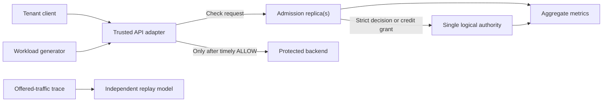

```mermaid
stateDiagram-v2
    [*] --> Ready
    Ready --> GrantPending: insufficient local units; retire remainder
    GrantPending --> Ready: confirmed unique grant
    GrantPending --> GrantPending: timeout; retry same sequence
    GrantPending --> Unavailable: authority/state integrity lost
    Ready --> Ready: atomically consume units; ALLOW
    Ready --> Limited: no usable units; confirmed quota limit
    Ready --> Unavailable: no usable units; authority unavailable
    Limited --> Ready: later eligible attempt
    Unavailable --> [*]: stopped epoch or explicit recovery
```

# RateGuard — Software Requirements Document

**Status:** Draft for review · **Date:** 2026-11-03 · **Source:** [PRD revision 5](PRD.md)  
**Releases:** A — strict core; B — evaluation; C — distributed credits  
**Purpose:** Define observable software behavior and verification obligations. No feature or metric in this document is claimed as implemented.

## 1. System boundary and terminology

RateGuard receives admission requests from a trusted backend adapter before that adapter forwards work. A single logical quota authority owns tenant budget state. Multiple admission replicas serve the same epoch. The authority may be a storage-backed service; the SRD does not select a storage product. A workload generator, reference model, trace replay tool, and metrics exporter support evaluation.



The adapter, not the untrusted client, determines tenant identity and operation class. The experiment uses synthetic tenants. Network placement alone does not prove authentication. A configured tenant has rate `r` (cost units/second), burst `B` (cost units), and operation costs `c` (positive integer units). An **epoch** fixes mode, policy digest, authority identity, initial balances, replica slots, and the timing convention. A new epoch is a stopped, explicitly initialized run, never a transparent continuation.

**Assumed environment:** one region, one logical authority, static policy, C++ service, gRPC interface, Docker-based local setup. Transparent authority failover, multi-region limits, live policy changes, billing, permits for long-running work, and arbitrary client-created tenants are outside the releases described here.

## 2. Normative interface semantics

The API is specified here at field/meaning level; the final `.proto` encoding and status mapping are blocking decisions D1–D2. Do not infer a successful admission from a transport status alone. Every completed application response has an explicit outcome.

| Operation | Required fields | Result |
| --- | --- | --- |
| `CheckAdmission` | trusted tenant context; configured operation ID; correlation ID; caller deadline | `ALLOW`, `LIMITED`, `INVALID`, `UNAUTHENTICATED`, `UNAVAILABLE`, or `OVERLOADED`; policy digest, mode, epoch, and diagnostic correlation ID where known |
| `AcquireCredit` (C) | tenant, registered replica slot/incarnation, epoch, policy digest, grant sequence, requested units, triggering operation cost, deadline | grant ID, granted units and sequence; or `LIMITED`, `INVALID`, `UNAVAILABLE`, `OVERLOADED` |
| `ReplayPolicies` (B, offline) | complete versioned offered trace, initial state, policies A/B | deterministic per-policy decisions, per-tenant comparison, provenance hashes, and validation errors |

The public adapter translates a received `LIMITED` into HTTP 429 and `UNAVAILABLE`/`OVERLOADED` into HTTP 503 in the sample integration. Other transport mappings, including gRPC status versus application outcome, are fixed by D2. No limit response is returned as 429 when the authority is unreachable. An estimated retry delay means earliest eligibility if no one else consumes the tenant's units under the same policy; it is not a reservation.

An attempt begins when `CheckAdmission` is invoked. In strict mode its **commit** is the atomic authoritative spend. In credit mode its commit is atomic local consumption of a previously confirmed grant; authority allocation is a separate commit. A caller may time out after either commit. The adapter forwards at most once only after receiving `ALLOW` before its own deadline and while the epoch remains active. A late response is ignored. It never refunds because of timeout or downstream failure. An application-level repeat is a new, chargeable attempt; the correlation ID is not a deduplication key.

The service must bound pending requests, authority waits, and response payloads. The concrete byte, queue, and time limits are D6. Unauthenticated/unknown-tenant/unknown-operation calls must not create quota state. Client-provided cost, tenant override, or time cannot reduce the configured charge or increase allowance.

## 3. State and mathematical contracts

### 3.1 Strict mode (A)

For tenant `i`, let `B_i > 0`, `r_i > 0`, current balance `b_i ∈ [0,B_i]`, and `Δt ≥ 0` elapsed authority time since the last accounted state. At one atomic decision point:

```text
available_i = min(B_i, b_i + r_i × Δt)
if available_i ≥ c:
    outcome = ALLOW
    next_balance_i = available_i − c
else:
    outcome = LIMITED
    next_balance_i = available_i
```

State may advance refill time on `LIMITED`, but no cost is charged. Decisions for one tenant must admit a sequential history compatible with real-time precedence of nonoverlapping completed calls. For every half-open interval `[t0,t1)` under the declared authority clock and boundary convention, total committed cost must satisfy:

```text
A_i([t0,t1)) ≤ B_i + r_i × (t1 − t0)
```

The interval envelope is necessary, not sufficient: serial eligible requests must be admitted. Calls with equal authority timestamps require a stable authoritative order. Rounding must never mint more credit than the specified reference model. Numeric representation, time units, overflow bounds, and clock-jump behavior are D3–D4. If the authority loses state or its identity changes, serving does not recreate a full bucket.

### 3.2 Distributed credits (C)

At epoch start, fix `N` distinct replica slots and `Q_i` for each tenant with `max_operation_cost_i ≤ Q_i ≤ B_i`. The mode cannot share the same tenant budget with strict admission inside one epoch. A slot is tied to one process incarnation and cannot be reassigned before a quiesced new epoch.

The authority uses the same token-bucket accounting to atomically spend each grant. A grant carries tenant, epoch, slot, incarnation, monotonically increasing sequence, granted units, and a unique grant ID. At most one allocation is in flight per tenant/slot. At most one confirmed batch of `Q_i` units is available locally for each tenant/slot; there is no prefetch. A grant may contain fewer than `Q_i` units only when it covers the triggering request cost. If not enough units exist for that cost, allocation returns `LIMITED` without charging.

A replica atomically consumes `c` local units before returning `ALLOW`. If its remainder cannot pay the triggering cost, it retires and records that remainder before seeking a new grant. Retired units never return to the authority. It must not issue two concurrent grants for the same tenant/slot. The authority persists the current sequence/result for the slot so retrying that sequence returns the same result with no second charge; stale or skipped sequences are rejected. A grant is activated once. A timeout with unknown allocation outcome blocks the next sequence until the same sequence is resolved. The concrete sequence width, wraparound policy, and storage durability mechanism are D3/D5.



**Conservation invariant:** every locally committed unit belongs to exactly one unique confirmed authority grant; a unit cannot be spent twice or transferred to another tenant/epoch. All confirmed, in-flight, retired, and stranded units must be accounted for in the correctness history. For any interval `[t0,t1)` with the stated common time interpretation:

```text
A_i([t0,t1)) ≤ B_i + r_i × (t1 − t0) + N × Q_i
```

At most `NQ_i` previously allocated units can be carried into the interval; new grants are bounded by the authority bucket. This is a conservative additional burst allowance, not strict-equivalent admission. D4 must resolve how local event times are compared with the authority's clock before code or tests claim this real-time bound. A process that crashes strands its units; a timeout is not proof of death and cannot trigger reclamation.

### 3.3 Epoch and failure invariants (A/C)

A replica becomes ready only after verifying matching mode, policy digest, epoch, and authority identity. A restarted strict replica joins the existing state. A restarted credit replica cannot resume or replace an old slot's units unless a separately designed durable local-state protocol exists; v1 requires a new quiesced epoch. No tenant bucket is lazily initialized after loss, eviction, or unknown identity. The only allowed initialization is explicit epoch creation before traffic.

When authority connectivity is lost, strict checks without a committed result do not authorize forwarding. A credit replica may spend already confirmed local units but cannot obtain new grants. If authority state disappears, its identity changes, rollback is suspected, or a policy mismatch is observed, new authority commits stop. Already isolated old credit replicas may still have confirmed units: activation of a new epoch therefore requires positive fencing/drain evidence, not a mere timeout. The exact mechanism is D5 and belongs in HLD.

The PRD deliberately excludes transparent authority promotion. Atomic server-side operations and durable distributed history are distinct properties. No test or documentation may claim strong failover from atomic operations alone.

## 4. Functional requirements

Each row states **trigger/input → required result/error → verification**. Acceptance test IDs refer to section 7. The table is normative; implementation mechanism remains open unless required to preserve the contract.

| ID | Release · PRD | Trigger/input → required behavior and error | Acceptance |
| --- | --- | --- | --- |
| FR-001 | A · 001,008 | On startup with a valid epoch, each replica verifies authority identity, policy digest, and mode before readiness; mismatch → unavailable, never a new bucket. | AT-01 |
| FR-002 | A · 002,003 | On a trusted check with eligible cost, atomically refill/spend and return `ALLOW`; insufficient funds → `LIMITED` without cost spend. | AT-02, AT-03 |
| FR-003 | A · 003,008 | On unknown identity/operation, invalid cost or policy, or untrusted override → `INVALID`/`UNAUTHENTICATED`, with no quota state creation or mutation. | AT-04 |
| FR-004 | A · 004 | On another tenant's burst, one tenant's decisions cannot spend another's units; overload is reported separately from quota denial. | AT-05 |
| FR-005 | A · 005 | On received result, return distinguishable outcome, mode, epoch, digest and correlation; return retry estimate for `LIMITED` when calculable; malformed request → `INVALID`. | AT-06 |
| FR-006 | A · 005 | On timeout, cancellation, or late `ALLOW`, adapter does not forward or refund; timely `ALLOW` permits at most one forwarding action. | AT-07 |
| FR-007 | A · 007 | On replica restart or transient authority disconnect, preserve existing budget; undecidable strict check → `UNAVAILABLE`. | AT-08 |
| FR-008 | A · 007,015 | On lost/missing state, authority identity change, or suspected rollback → no new authoritative admission; explicit stopped epoch required. | AT-09 |
| FR-009 | A · 009 | For every attempt, count offered, committed, responded, forwarded, completed and unresolved events separately; never label quota exhaustion as dependency failure. | AT-10 |
| FR-010 | A · 015 | When queue/storage deadlines or bounded capacity are reached → `OVERLOADED` or `UNAVAILABLE` without unbounded buffering or unauthorized forwarding. | AT-11 |
| FR-011 | B · 006 | On complete versioned offered trace and two policies, replay both from identical initial state with deterministic tie-break order; incomplete trace → validation failure. | AT-12 |
| FR-012 | B · 006 | On replay completion, report per-tenant offered/admitted counts/cost, changed decisions, first divergence and trace/policy hashes; no claim to predict changed demand. | AT-12 |
| FR-013 | B · 010–012 | On documented clean setup, start service, produce machine-readable run data and a report linking requirements to evidence; missing dependency/config → explicit setup failure. | AT-13 |
| FR-014 | C · 016 | At epoch initialization, accept exactly one mode and fixed registered slots; later mode, slot, incarnation, or digest mismatch → rejection/unavailable with no credit transfer. | AT-14 |
| FR-015 | C · 017 | On `AcquireCredit`, spend at most one valid grant for a sequence; duplicate sequence → identical result, stale/skipped sequence → rejection, unknown result → no new sequence. | AT-15 |
| FR-016 | C · 017,018 | On local eligible attempt, atomically spend unique confirmed units; insufficient remainder → retire it before another grant; no double spend. | AT-16 |
| FR-017 | C · 018 | Across concurrent replicas, consumed units respect grant provenance and the stated `B + rΔt + NQ` interval bound; violations fail the release. | AT-17 |
| FR-018 | C · 019 | On credit replica crash/disconnect or authority loss, preserve stranded/uncertain-credit accounting; only confirmed local units may be consumed; no timeout reclamation. | AT-18 |
| FR-019 | C · 020 | For identical offered traces, collect authority calls/bytes, admitted cost, latency, errors, and stranded/retired units separately by mode. | AT-19 |
| FR-020 | A–C · 021 | Before generating a module, require a resolved source requirement, interface contract, invariants, and independent acceptance method; otherwise block that module as a specification decision. | AT-20 |

**Deferred:** PRD-013 live policy changes and PRD-014 permits for long-running work have no v1 FRs. They require new contracts before code generation.

## 5. Quality and operational requirements

These are proposed product gates from the PRD, not measured results. Unless specified otherwise, evaluate with frozen configuration and publish misses. Percentiles include only completed responses **and** a separate deadline-miss rate; omitting failed calls from the report is invalid.

| ID | Release · PRD | Measurable obligation | Evidence |
| --- | --- | --- | --- |
| NFR-001 | A/C · 002,017,018 | Zero observed model/conservation/bound violations across at least 1,000,000 decision attempts **per mode** with boundary and concurrent cases. Seeded double-spend/reject-all defects must be caught; credit mode also catches duplicate grant/bound defects. | AT-02, AT-17, AT-21 |
| NFR-002 | B/C · 004 | In each of five healthy 60-second runs below measured limiter knee, ≥99% of conforming attempts from two tenants each at 50% allowance receive timely `ALLOW` while a third offers 10× its allowance. Timeouts and unavailable count as failures. | AT-22 |
| NFR-003 | B/C · 011,020 | In each of five runs, p99 completed decision latency ≤5 ms at 5,000 offered checks/s, 1,000 tenants, three replicas, 50 ms deadline, 90% cost-1/10% cost-5; publish every run's timeout/error rate. | AT-23 |
| NFR-004 | C · 020 | At fixed N=3 and `Q=clamp(ceil(B/8),max_cost,B)`, credit mode uses ≥50% fewer authority operations per 1,000 admitted cost units than strict mode on the same trace; five-run medians. | AT-24 |
| NFR-005 | C · 020 | Under NFR-004 conditions, credit mode preserves ≥95% of strict-mode admitted cost and also meets NFR-002/003. Stranded/retired units are reported. | AT-24 |
| NFR-006 | B/C · 010–012 | Two fresh setup-and-run reproductions with pinned inputs produce machine-readable results from which gate outcomes can be recalculated. | AT-13 |
| NFR-007 | B/C · 011 | Open-loop generator delivers ≥99.5% of scheduled arrivals; otherwise mark run invalid. Five measured 60-second runs follow a separate 30-second warmup; publish individual values and dispersion. | AT-25 |
| NFR-008 | A/C · 009,015 | Request queues, storage waits, state cardinality, and diagnostic data have documented finite limits; exceeding any bound returns an explicit error rather than growing without bound. Limits are D6. | AT-11 |

## 6. Data, observability, and retention

**Policy data:** tenant ID, operation ID/cost map, `r`, `B`, mode, digest, epoch, and (C) fixed slots and `Q`. Policy is immutable within an epoch. Unknown tenants do not create buckets. Numeric ranges, time resolution, and canonical digest encoding are D3.

**Authority state:** epoch/authority identity, tenant balances and last accounted times; (C) per-tenant/slot sequence and result. State must be sufficient to detect missing data before admission. Storage layout and persistence mechanism belong in HLD; no architecture document may assume that Redis replication implies lossless failover.

**Replica state:** strict replicas hold no independent allowance. Credit replicas hold confirmed grant ID, remaining units, current sequence, and unresolved allocation state for registered tenant/slot only. The SRD makes no durability promise for this local state. Restart strands units and cannot rejoin the same slot for credit spending.

**Telemetry:** aggregate counts for offered, committed, responded, forwarded, completed, limited, unavailable, overloaded, invalid, and unresolved. Capture decision latency, authority-call count/bytes, granted/consumed/retired/stranded cost, and build/runtime manifest. Tenant, grant, and correlation IDs must not become unbounded metric labels. A correctness-only history can contain pseudonymous IDs; it must be separately enabled and bounded.

**Replay input/output:** include schema version, immutable policy hashes, trace digest, seed, relative times and tie-break order, per-attempt tenant/operation, full initial state, model version, evaluated row count, and per-tenant comparison. Historical admissions alone are not a complete offered trace. Malformed rows fail the run; no silent omission. Published examples must use synthetic or pseudonymized identities.

**Retention decision:** D7 must define exact local log/trace retention and deletion before implementation. Until then, only bounded in-memory aggregate metrics and explicit user-invoked synthetic export are assumed. No production personal-data retention claim is authorized.

## 7. Verification plan and traceability

Test names below are evidence IDs, not claims that tests exist. Keep the reference model independent of the production decision routine. Correctness and performance runs are separate because instrumentation can change timing. State the tested revision, environment, random seed, and mode in every result.

| Evidence | Scenario and pass criterion |
| --- | --- |
| AT-01–04 | Start one/three replicas, mismatched epoch/digest, strict serial/concurrent boundary cases, numeric limits, bad identity and cost. Independent model matches; invalid attempts mint no units. |
| AT-05–07 | Noisy tenant, distinct outcomes/retry estimates, timeout after commit, late response, downstream error. No forwarding without timely `ALLOW`. |
| AT-08–11 | Replica restart, disconnect, lost authority state, bounded overload, and event-accounting reconciliation. Observe safe stop and unresolved attempts. |
| AT-12–13 | Identical replay inputs produce identical complete reports; malformed trace fails. Two clean setups reproduce machine-readable outputs. |
| AT-14–18 | Fixed slots, duplicate/out-of-order/unknown grants, atomic local spending, interval bound, crash and disconnection. No grant duplication or timeout reclamation. |
| AT-19–20 | Comparative report has all required denominators and each module has PRD→SRD→test evidence or an explicit blocker. |
| AT-21 | Inject double-spend, reject-all, duplicate grant, and bound-break defects; checker fails for each intended violation. |
| AT-22–25 | Frozen healthy workload, capacity/latency, credit-efficiency and admission preservation, generator delivery and five-run protocol. Every applicable threshold passes; raw runs retained. |

| PRD source | SRD requirement(s) | Evidence | Release |
| --- | --- | --- | --- |
| 001–003 | FR-001–003; NFR-001 | AT-01–04, AT-21 | A |
| 004–005 | FR-004–006; NFR-002 | AT-05–07, AT-22 | A/B |
| 006 | FR-011–012 | AT-12 | B |
| 007–008 | FR-001, FR-003, FR-007–008 | AT-01, AT-04, AT-08–09 | A |
| 009 | FR-009 | AT-10 | A |
| 010–012 | FR-013; NFR-003, NFR-006–007 | AT-13, AT-23, AT-25 | B |
| 013–014 | Deferred | New SRD required before implementation | Future |
| 015 | FR-008, FR-010; NFR-008 | AT-09, AT-11 | A |
| 016–019 | FR-014–018; NFR-001 | AT-14–18, AT-21 | C |
| 020 | FR-019; NFR-003–005 | AT-19, AT-23–24 | C |
| 021 | FR-020 | AT-20 | A–C |

## 8. Decisions required before code generation

These defaults are proposals, not approved or implemented design facts. Resolve each before generating the affected module, or explicitly exclude that module from the release. A small prototype or documented measurement may justify changing a default.

| ID | Proposed default and rationale | Affected code |
| --- | --- | --- |
| D1 — gRPC schema | Versioned `CheckAdmission` and `AcquireCredit` messages with explicit outcome enums and optional retry estimate. Avoid conflating transport failure with quota denial. Fix exact fields/compatibility policy. | Adapter, service, clients |
| D2 — status mapping | Application outcomes in successful gRPC responses; transport failure means unknown commitment. Define gRPC status for invalid/auth, deadline, and unavailable, plus HTTP mapping. | Adapter, clients |
| D3 — numeric model | Fixed-point integer balances, rates, and integer microsecond time; checked wide intermediates and explicit maximums. Avoid floating-point cross-language drift and overflow. Fix rounding and sequence widths. | Authority, replay, checker |
| D4 — time model | Authority-controlled monotonic time while the epoch runs; restart stops epoch. Define how credit local event times are related to the authority timeline so the interval bound can be tested. No trust in caller clocks. | Authority, credit replica, checker |
| D5 — identity/fencing | One externally detectable authority incarnation; credit slot/incarnation cannot be reused inside epoch; operator-driven drain/fence before new epoch. Specify positive evidence, including isolated old replicas. | Startup, recovery, operations |
| D6 — resource caps | Explicit finite per-replica outstanding-request limit, authority timeout, tenant-state count, diagnostics/history limit, and overload response. Choose values from measured host capacity. | Service, telemetry |
| D7 — retention/privacy | Synthetic benchmark artifacts retained under project control; bounded correctness histories disabled by default. Decide exact duration, size cap, deletion behavior, and pseudonymization before publishing data. | Replay, telemetry |
| D8 — benchmark policies | Freeze concrete `B`, `r`, operation costs, routing skew, and offered workload before measurement; satisfy `max_cost≤Q≤B`. Avoid tuning to the gate after seeing results. | Workload generator, report |

**Review findings:** the PRD's interval bounds require an explicit clock model, especially for local credit spending; D4 is a release-C blocker. The PRD requires failure detection without transparent failover; D5 must prevent old-credit holders from crossing epoch boundaries. Exact numerical thresholds are product gates, not implementation evidence. No availability SLA or external production readiness is inferred.

## 9. Source and document status

This SRD is derived from [PRD revision 5](PRD.md). The PRD's [research and existing-system references](PRD.md#how-research-improved-the-decisions) explain why the strict/credit comparison, skew tests, and fault boundaries were chosen. This document adds proposed interface and verification defaults only where required for an implementable contract. HLD will choose components and persistence; LLD will define internal state transitions and concurrency mechanisms. Neither may silently weaken this SRD's release gates.
